# DesignSense: from a design space to a decision

DesignSense shows a table of generated design options, with their pictures and 3D models, as a set of linked views. You use it for four tasks: understanding the design space, narrowing it down, deciding between the options that are left, and sharing the result.

**[Open DesignSense](https://designsense.app/)** · [Source on GitHub](https://github.com/abuzreq/DesignSense) · [The paper](https://journals.sagepub.com/doi/10.1177/14780771241260854)

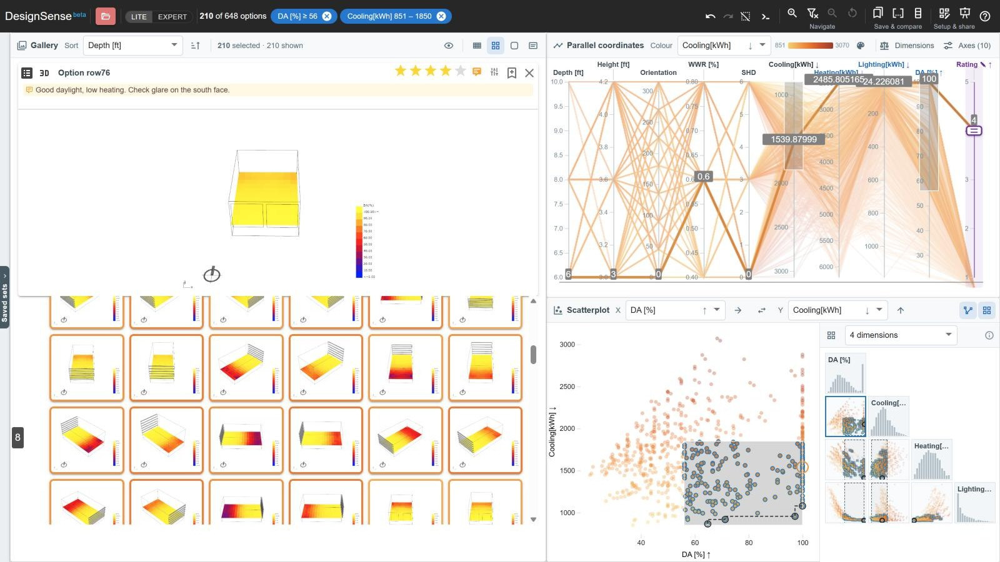

*The Windows study from Design Explorer: 648 window designs, narrowed to 210 by the two filters in the bar. Arrows on the axes show which way is better for each output, and the inspected option has a rating and a note.*

This guide follows one study from start to finish. It covers how the data is made, what the files look like and how to load them, and then each of the four tasks.

<!-- contents -->
- Start here
  - [The process at a glance](#the-process-at-a-glance)
- Getting the data in
  - [Generate](#generate)
  - [Prepare](#prepare)
  - [Load](#load)
- Finding your way
  - [Look around](#look-around)
- The four tasks
  - [Understand](#understand)
  - [Narrow](#narrow)
  - [Decide](#decide)
  - [Share](#share)
- About
  - [The research](#the-research)

> [!TIP]
> **New here?** The app has a guided tour that takes a few minutes. It uses a small sample dataset and goes through the same four tasks, pointing at each view and control as it goes. Start it from the welcome screen, or from **Help ▸ Take the tour** at any time. [Take the tour](https://designsense.app/?tour=start)

## The process at a glance

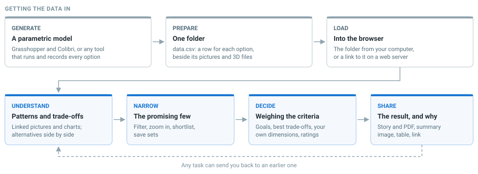

| Stage | What happens | Where |
| --- | --- | --- |
| [Generate](#generate) | A parametric model is run for every combination of its inputs, or for the combinations an optimiser picks, and each run is recorded | Grasshopper with Colibri, Galapagos or Octopus, or any tool of your own |
| [Prepare](#prepare) | The runs are stored in one folder: `data.csv`, a picture of each option, and optionally a 3D model of each | Your computer |
| [Load](#load) | You open the folder from your computer, or from a link once it is on a web server | DesignSense |
| [Understand](#understand) | Find the patterns, relationships and trade-offs in the design space, and work out which criteria matter | DesignSense: the [linked views](#look-around) |
| [Narrow](#narrow) | Find the options that meet those criteria, and set promising ones aside | DesignSense: filters, shortlist, sets |
| [Decide](#decide) | Choose, weighing measured and judged criteria together | DesignSense: goals, Compare, best trade-offs, weighted scores, your own criteria |
| [Share](#share) | Give other people the result and the reasoning behind it | DesignSense: story, summary image, table, link |

The first three steps get the data into DesignSense. The other four are the tasks themselves, and you will move back and forth between them: what you learn in one often sends you back to an earlier one.

DesignSense does not upload your data. It is read in your browser, and your work (sets, shortlist, ratings, notes) is saved in that browser too.

## Generate

A study is a table with **one row for each design option**. Its columns are the inputs that produced the option, such as a width, a glazing ratio or an orientation, and the outputs that were measured or simulated for it, such as cost, daylight or cooling load. Each option can also have a picture and a 3D model, stored as files next to the table.

DesignSense reads the format that [Design Explorer](https://tt-acm.github.io/DesignExplorer/) introduced, so any tool that can make a study for Design Explorer can make one for DesignSense.

<!-- tabs -->

### With Grasshopper: Colibri

**Colibri** is a free set of Grasshopper components by [CORE studio at Thornton Tomasetti](https://www.thorntontomasetti.com/core-studio), the makers of [TT Toolbox](https://www.food4rhino.com/en/app/tt-toolbox). It steps your sliders through every combination of values. After each step it waits for the definition to recompute, then records the inputs, the outputs and a picture of the result.

Download [Colibri from Food4Rhino](https://www.food4rhino.com/en/app/colibri) (Rhino 7 and 8). Once installed, it appears under the TTToolbox tab in Grasshopper.

It has four components:

| Component | What it does |
| --- | --- |
| **Colibri Inputs** (the Iterator) | Takes sliders, value lists and panels, and steps through every combination of their values, or a subset that you choose |
| **Colibri Outputs** | Collects the values you want to record for each iteration, such as areas, costs or simulation results |
| **Colibri Aggregator** | Combines the inputs and outputs of every iteration into one dataset and writes it to a folder. It can also save a preview image of each iteration |
| **Colibri Image Settings** | Sets the size of the preview image, or records several views per iteration |

To set it up, connect the sliders that define your design space to Colibri Inputs and the results you want to compare to Colibri Outputs. Connect both to the Aggregator and run it. The number of runs grows quickly (five sliders with six steps each make 7,776 runs), so start with coarse steps.

Colibri writes **a folder** (`C:\Colibri` by default) that contains `data.csv` and one image per iteration. That folder is your study. [Prepare](#prepare) describes what is in it, and [Load](#load) explains how to open it.

> [!NOTE]
> **Coming from Design Explorer?** Design Explorer had you upload the Colibri folder to Google Drive and paste its link. DesignSense cannot read Google Drive folders. Open the folder from your computer instead, or put it on a web server such as a GitHub repository. [Load](#load) covers both.

### With Grasshopper: an optimiser

You do not have to run every combination. When there are too many, an optimiser can sample the design space for you. It tries some options, looks at the results, and concentrates its remaining runs where the results are better.

- **Galapagos**, which is included with Grasshopper, searches for the best value of a single objective.
- **[Octopus](https://www.food4rhino.com/en/app/octopus)**, a plugin, works with several objectives at once and searches for the best trade-offs between them.

To turn a run of either into a study, record every option the solver tries, with its picture, as a row of `data.csv`. Recording only the final results is not enough. People have used Colibri's Aggregator for this, letting the solver move the sliders in place of Colibri Inputs. Check that it records each run in the version you have.

Keep in mind that an optimiser does not sample evenly. Most of its options are close to the good results it found, and few are anywhere else. The charts therefore show where the solver searched, and a relationship between an input and an output is less reliable than one you see in an even sweep. This is fine for [Narrow](#narrow) and [Decide](#decide), where you mainly need the good options. For [Understand](#understand), an even sweep works better, even a coarse one. You can also combine the two: run a coarse sweep first, then use an optimiser to add options in the region you want to look at more closely.

### With anything else

The format does not depend on Grasshopper. A Python script, a Dynamo graph, an optimisation run or a spreadsheet works just as well, as long as it produces a CSV with one row per option. Pictures are optional. Without them the gallery shows cards with no thumbnail, and the charts work as usual.

<!-- /tabs -->

### 3D models

3D models are optional. DesignSense can show `.glb`, `.gltf` and `.obj` files, and the `.json` scenes that Design Explorer uses.

- **A Design Explorer study** with a `threeD` column of `.json` scenes loads as it is.
- **Rhino 8**: select the geometry, choose *File ▸ Export Selected*, and pick glTF from the file-type list.
- **Rhino 7**: install McNeel's glTF exporter from the Package Manager. Alternatively, export *Wavefront (.obj)* and tick *Map Rhino Z to OBJ Y* so that the model stands upright.
- **Grasshopper**: bake the geometry into Rhino, then export it as above. Export one file per option and give it the same name as that option's image.

A `.glb` is the safest choice because it is a single self-contained file. Add a `model3d` column to `data.csv` that contains each option's file name.

## Prepare

A study is one folder:

```
my-study/
├── data.csv          one row per option
├── 0001.png          the picture the row names
├── 0001_2.png        a second view of the same option (optional)
├── 0001.glb          its 3D model (optional)
├── 0002.png
└── …
```

`data.csv` starts with a header row, followed by one row per option. This header comes from one of Design Explorer's own studies, which loads without changes:

```
in:Depth,in:Height,in:Orientation,in:WWR,in:SHD,out:Cooling[kWh],out:Heating[kWh],out:Lighting[kWh],out:DA,img,threeD
```

### What the column names mean

DesignSense works out what a column is from its name. The prefix is not shown in the interface.

| Column | Read as | Example |
| --- | --- | --- |
| `in:` | An input: a parameter of the design | `in:width` |
| `out:` | An output: something measured or simulated | `out:cost` |
| `min:` | An output where lower is better | `min:cost` |
| `max:` | An output where higher is better | `max:daylight` |
| `name:` | The name shown for each option, in place of "Option 12". DesignSense also offers a column called `Name`, `Description`, `Label` or `Title` for this | `name:variant` |
| `ID` | The option's identifier. Without this column, the rows are numbered | `ID` |
| `img` or `image` | The option's picture | `img` |
| `img_2`, `img_3` … | Further views of the same option, in that order | `img_2` |
| `model3d`, `3d` or `threeD` | The option's 3D model. Use `model3d_2` and so on for more | `model3d` |
| `custom:` | A dimension whose values you enter by hand in DesignSense | `custom:looks` |
| `weighted:` | A weighted sum of other dimensions, made in DesignSense | `weighted:score` |
| anything else | A plain dimension | `floors` |

Names are not case-sensitive. Colibri writes `in:` and `out:`. `min:` and `max:` are specific to DesignSense, and you can set the same goals after loading without editing the file. DesignSense writes `custom:` and `weighted:` columns itself when you [download a table](#share), so that your own criteria are restored when you load that table again.

### What the cells hold

- **Numbers** become axes that you can filter, sort and colour by. A column counts as numeric when every filled cell in it is a number.
- **Text** is shown in the inspector and in Compare, and you can sort and colour by it. It does not become an axis.
- **Empty cells** are treated as missing values, not as zero.
- **Picture and model cells** contain either a file name (`0001.png`), which DesignSense looks for in the same folder as `data.csv`, or a full link (`https://…/0001.png`). Pictures can be `.png`, `.jpg`, `.gif`, `.webp`, `.bmp` or `.svg`.
- Commas, tabs and semicolons all work as separators.

> [!WARNING]
> A column called `image_url` or `picture` is **not** read as a picture. Rename it to `img`.

### Coming from Design Explorer

- `in:`, `out:` and `img` mean the same thing, so a Colibri folder loads as it is.
- The `threeD` column and its `.json` scenes are read.
- A `Description` column, which Design Explorer's samples use, provides the option names.
- A settings file in the folder is ignored. You set goals, colours and layout in DesignSense.
- Google Drive links do not work. See the note under [Generate](#generate).

## Load

**Load Data** is in the toolbar and on the welcome screen. It gives you three ways to open a study. [Open Load Data](https://designsense.app/?open=load)

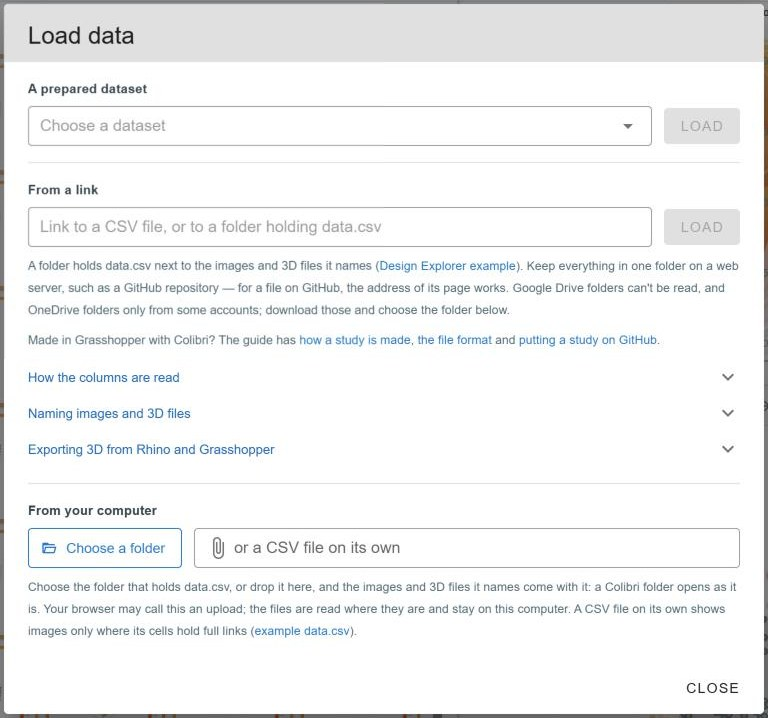

*The Load data dialog, with its three sources: a prepared dataset, a link, and a folder or CSV file from your computer.*

<!-- tabs -->

### A prepared dataset

DesignSense comes with ten sample studies, including three of Design Explorer's own. Loading one is the quickest way to see what a study looks like in the app.

### From your computer

- **Choose a folder**, or drop one onto the dialog. DesignSense finds `data.csv` in it and shows the pictures and 3D files that the table names. Use this to open a Colibri folder directly from where Colibri wrote it. Your browser may ask you to confirm an "upload". Despite the wording, the files are read on your computer and are not sent anywhere.
- **Choose a CSV file** on its own to load just the table. Pictures then appear only for cells that contain full links.

A study that you open from your computer has no link, so you cannot [share the dataset itself](#share). To do that, put the study online and load it from a link.

### From a link

Paste a link to a CSV file, or to a folder that contains `data.csv`.

| The link | What DesignSense does |
| --- | --- |
| Ends in `.csv`, `.tsv` or `.txt` | Reads that file, and looks for the files it names in the same place |
| A file page on github.com | Reads the raw file behind the page |
| Anything else | Treats it as a folder and reads `data.csv` inside it |
| A OneDrive folder | Works for some accounts only. Microsoft blocks the rest |
| A Google Drive folder | Not read. Download the folder and choose it from your computer |

**Putting a study on GitHub** is the simplest way to get a link that works for everyone:

1. Create a public repository and upload the whole folder: `data.csv`, the pictures and the models.
2. Open `data.csv` on GitHub and copy the address of the page.
3. Paste it under *From a link* and press Load.

Any other web server works in the same way, provided it allows other sites to read its files.

<!-- /tabs -->

### Checking how the columns were read

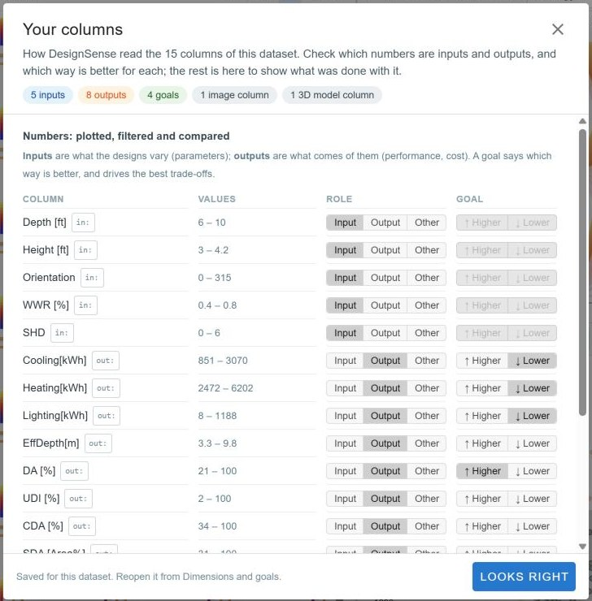

The first time you load a study of your own, the **Your columns** dialog opens and shows how DesignSense read each column. There you can change a column to an input, an output or neither, set which direction is better for an output, and choose the column that names the options. DesignSense remembers these choices for that study.

*Your columns for the Windows study. It has five inputs and eight outputs, four of them with a goal, plus the columns that hold the pictures and the 3D models.*

### When a load goes wrong

| The message | What to do |
| --- | --- |
| "No data.csv was found in that folder." | Check the link, or link to the CSV file itself. In a folder from your computer, the table must be a `.csv` file |
| "That link opened a web page, not a CSV file." | On GitHub, open the file itself, not the folder or the repository |
| "… denied access." or "Couldn't reach …" | The files are not public, or the server does not allow other sites to read them. Files on GitHub can be read |
| "DesignSense can't read Google Drive folders." | Download the folder and choose it from your computer |
| "Each column needs its own name …" | Two columns have the same header. Rename one of them |
| "N image or model files named in the data could not be found." | If you opened the CSV on its own, choose its folder instead. Otherwise the names in the `img` column do not match the files, so check the spelling and the extension |
| The pictures are missing, with no message | Rename the picture column to `img` |

## Look around

All the views show the same options and stay in step: when you filter, select or inspect in one view, the others update. **Help ▸ Take the tour** shows each view in turn in the app.

| View | What it shows |
| --- | --- |
| **Gallery** | A picture of every option. You can sort by any column, change the picture size, or switch to *Details* to read the values side by side |
| **Inspector** | One option in detail: its picture at full size, its other views, its 3D model and its values. Click a picture, a line or a dot to inspect that option |
| **Parallel coordinates** | Each axis is a dimension and each line is an option, so one line shows all of an option's values |
| **Scatterplot** | Each dot is an option, positioned by two dimensions that you choose. The **Overview** next to it shows every pair of dimensions at once |

**Colour.** You choose one column to colour by, and every view uses it: the lines, the dots and the border of each gallery card. Click an axis title to colour by that dimension, and pick a palette from the menu next to the colour key. Four other colours are fixed and always have the same meaning:

| Colour | Meaning |
| --- | --- |
| Blue | Selected: the options that pass your filters or are in your selection |
| Dark | Inspected: the option shown in the inspector |
| Orange | On the shortlist |
| Bright blue outline | Keyboard focus |

**Lite and Expert.** DesignSense starts in Lite mode, where you narrow the options with filters. Switch to Expert with the toggle in the toolbar. In Expert you build a selection step by step instead of filtering, and you also get clusters, the Analysis panel and layout editing. Everything below works in Lite unless stated otherwise.

The next four sections cover the four tasks. You will rarely do them once and in order. What you learn while deciding may send you back to narrow in a different way, and sharing a result often starts another round. The examples all use the 648 window designs shown at the top of this guide. Imagine an architect who has to choose a few of them to show a client.

## Understand

*Find the patterns, relationships and performance trade-offs in the design space. Compare alternatives and weigh their strengths and weaknesses to learn which criteria matter.*

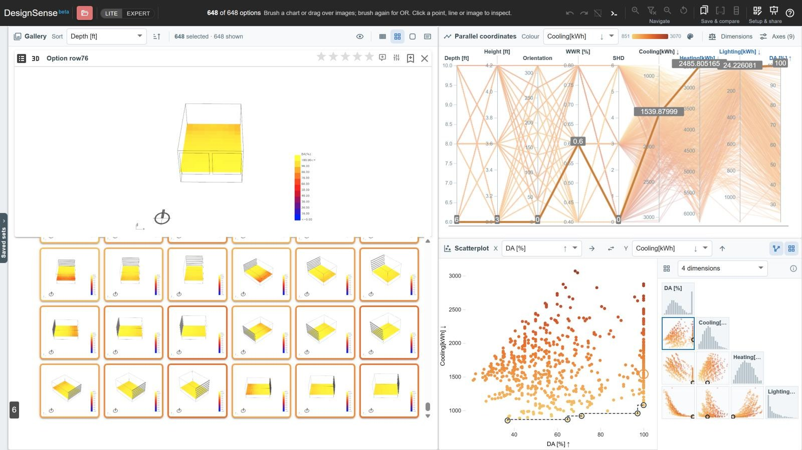

*All 648 options, coloured by cooling. One option is inspected, so its picture is open on the left and its line is drawn thicker across the axes, with its values. In the scatterplot, the dashed line connects the best trade-offs between daylight (DA) and cooling. The overview next to it shows the other pairs.*

**Try it:** [Open the Windows study](https://designsense.app/?sample=windows) · [Tour this task](https://designsense.app/?tour=understand)

- **Patterns.** The lines in the parallel coordinates show where options are concentrated and where there are few. Drag an axis title to put two axes next to each other. If the lines between them run roughly level, the two dimensions rise together. If the lines cross, one goes up as the other goes down.
- **Relationships.** The scatterplot shows one pair of dimensions in detail. The Overview shows every pair at once, which helps you spot the pairs worth a closer look. Colour by a third dimension to see what else changes with them.
- **Trade-offs.** After you give each output a [goal](#decide), arrows on every axis show which direction is better, and the scatterplot can draw a line through the best trade-offs for the pair it shows.
- **Form and performance together.** Sort the gallery by a column to see how the designs change as that value changes. When you inspect an option, its line and its dot are highlighted in the charts, so you can read its performance next to its form: low cooling and good daylight, for example, but more heating.
- **Strengths and weaknesses.** **Compare** shows up to eight options side by side. It dims the rows where all the options have the same value and marks the highest and lowest value in each row, so the differences stand out.
- **New criteria.** Looking at alternatives often brings up criteria that are not in the data. You might notice, for example, that the deep-set windows on the south face look right. Record observations like this as a note on the option. [Decide](#decide) explains how to turn one into a dimension of its own.

The example below shows how four common patterns look in the parallel coordinates and in the scatterplot, using the same options for both.

<!-- live: patterns -->
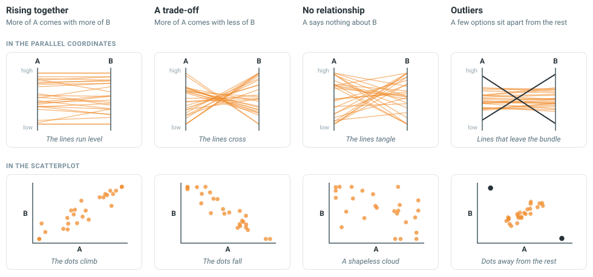

*Two dimensions, A and B. An axis without a goal has its low values at the bottom, as drawn here. An axis with a goal has its better values at the top. When both axes have goals, level lines therefore mean that the two goals improve together, and crossing lines mean that they conflict.*

Expert mode adds two more aids. **Clusters** group similar options and show one picture for each group. **Analysis** reports the spread of every dimension, the outliers, and which inputs affect which outputs.

## Narrow

*Look for the alternatives that satisfy your criteria, including criteria that emerge along the way. An alternative is a proposal and not merely a data point, so even an option that performs poorly can lead to a better one. The options you select are not final either. You refine them, or use them to guide the next round of exploration.*

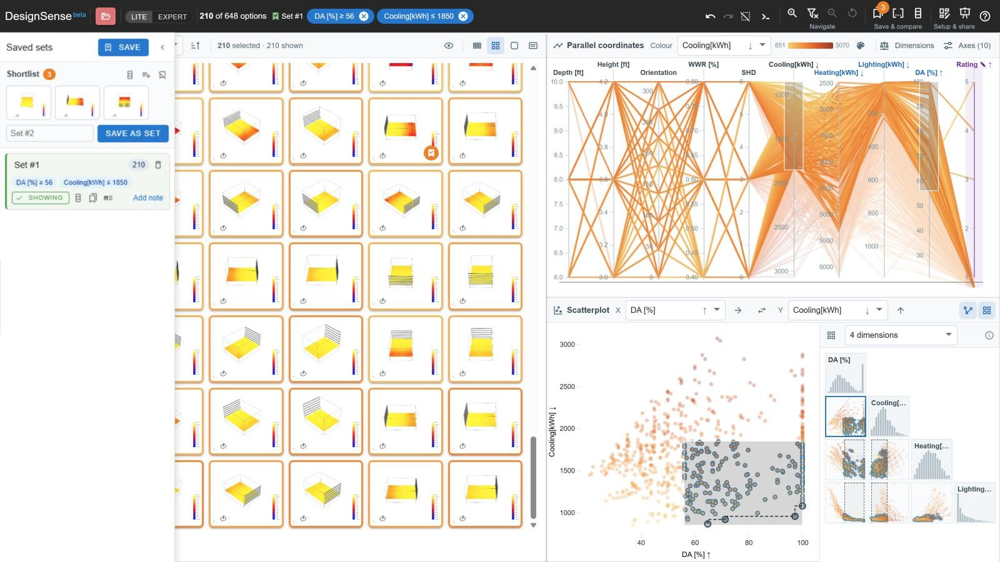

*Two filters, daylight of at least 56% and cooling of at most 1,850 kWh, leave 210 of the 648 options, and the charts highlight them. The drawer on the left holds a shortlist of three options and the set saved from these filters.*

**Try it:** [Open the Windows study](https://designsense.app/?sample=windows) · [Tour this task](https://designsense.app/?tour=narrow)

- **Filter.** Drag along an axis in the parallel coordinates, or drag a box in the scatterplot. Each filter appears as a chip in the bar at the top, next to a count of the options that are left. Remove a chip to remove its filter. Undo and redo step through your filter changes.
- **Pick by eye.** Drag a box over pictures in the gallery to keep only those options. This lets you narrow by what the designs look like as well as by their numbers.
- **Ask.** Type a request into the assistant's box in the toolbar, such as *cooling under 1850* or *what do these have in common*. The assistant applies it or answers the question. It runs in your browser. Press `/` to jump to it.
- **Go deeper.** **Zoom in** makes the remaining options the whole collection. The charts rescale to fit them, and you can filter again within them. **Exclude** does the opposite and removes those options from the collection. **Step back** undoes the last zoom or exclusion, and **Reset** restores the full collection.
- **Keep proposals aside.** Click the bookmark on a card to add that option to the **shortlist**. The shortlist is not affected by filtering or zooming, so an option that fails a filter but still interests you stays there while you keep looking.
- **Save where you are.** A **set** saves the current options together with the filters that produced them. Restore a set to return to that point. You can also keep several sets as alternative directions and compare them later.
- **Start the next round.** You can load the table you [download](#share) as a smaller study of its own. The input values of the options you kept also tell you where to rerun the parametric model in finer steps.

### Filters in Lite, a selection in Expert

Lite and Expert narrow in different ways. The difference is in how each new brush combines with the ones before it.

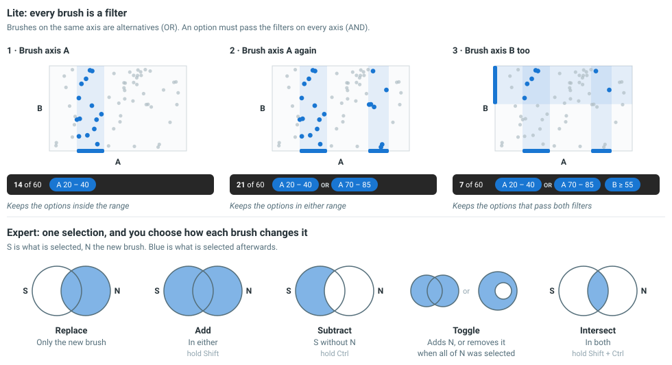

*Top: three brushes in Lite, with the filter bar after each one. Bottom: the five ways Expert can combine a new brush with the current selection.*

**In Lite, every brush is a filter, and filters always combine in the same way.**

- A second brush on the same axis adds an alternative range. An option passes if it is in either range (OR). A second box in the scatterplot works the same way.
- An option has to pass the filters on every axis (AND), so brushing another axis always leaves fewer options.
- Dragging an existing brush changes its filter. It does not add a new one.

This rule cannot express every combination. In return, your filters always read as a plain list of criteria, and the order in which you made them does not matter.

**In Expert there are no filters. You have one selection, and you choose how each new brush changes it.** A brush can replace the selection, add to it, subtract from it, toggle it, or intersect with it. Hold Shift to add, Ctrl to subtract, and both to intersect. A step does not have to be a brush. It can also be a cluster, a lasso in the scatterplot, or a single option that you click.

This lets you make selections that filters cannot, such as the options that are bright or cool, except those that need a lot of heating. To get that selection, select the bright options, add the cool ones, then subtract the ones with high heating. Unlike filters, the order of these steps affects the result.

### Read where you are

As you narrow, the filter bar at the top shows where you are in the design space.

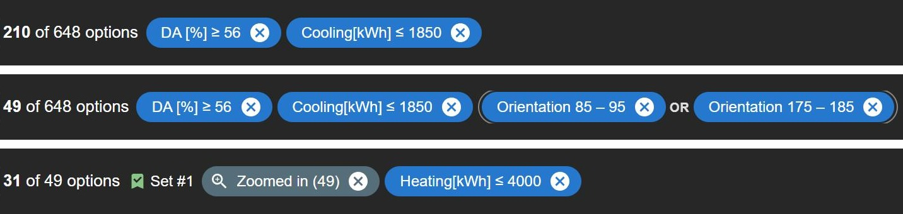

*The filter bar at three points in the Windows study.*

- **The count** shows how many options are left, here 210 of 648.
- **Each chip is one criterion.** It names the dimension and the range you kept, in the units of the data. A chip such as `≥ 56` comes from a brush that reaches the top of its axis. Click the × on a chip to remove that criterion.
- **OR links two brushes on the same axis.** In the middle row, the orientation is either about 90 or about 180. Each of the two chips has its own ×.
- **A grey chip marks a zoom.** In the bottom row, *Zoomed in (49)* means the collection is now those 49 options, and the count is out of 49. The chip's tooltip lists the criteria that were active when you zoomed. Click its × to zoom back out.
- **The name of a set** appears next to the count when the current filters are the ones saved in that set. It tells you that you are back at that saved point.

You can read the bar from left to right as a sentence: daylight of at least 56%, and cooling of at most 1,850 kWh, and an orientation of about 90 or about 180. A description like this is easier to remember and to explain to a colleague than a list of 49 option numbers. It is also what DesignSense saves with a set and writes into the note of a captured view.

Expert describes its selection in a similar way. A strip next to the count shows the selection as a single statement that uses AND, OR and NOT. DesignSense simplifies this statement to the shortest one that selects the same options. Click the count to see the full statement and the steps it came from. Undo takes you back through those steps one at a time.

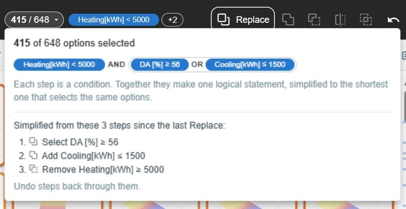

*Expert after three steps: select the bright options, add the cool ones, then remove those with high heating. The statement describes the 415 options that are selected.*

## Decide

*Combine objective and subjective criteria to make the final choice.*

Deciding is difficult. Goals conflict, the people involved weigh them differently, and some of what matters was never measured. No single method resolves all of this, so DesignSense offers several that you can use on their own or together. All of them start from the same step, which is to say what "better" means.

<!-- cards -->
- **[Compare as you go](#compare-as-you-go)**<br>Put options side by side to find out what you like about each one.
- **[Find the best trade-offs](#find-the-best-trade-offs)**<br>Set aside every option that another option beats on all the goals.
- **[Score the options](#score-the-options)**<br>Combine the goals into one number, and try more than one weighting.
- **[Add your own judgement](#add-your-own-judgement)**<br>Rate options, write notes, and add criteria that are not in the data.

**Try it:** [Tour this task](https://designsense.app/?tour=decide)

### Say what better means

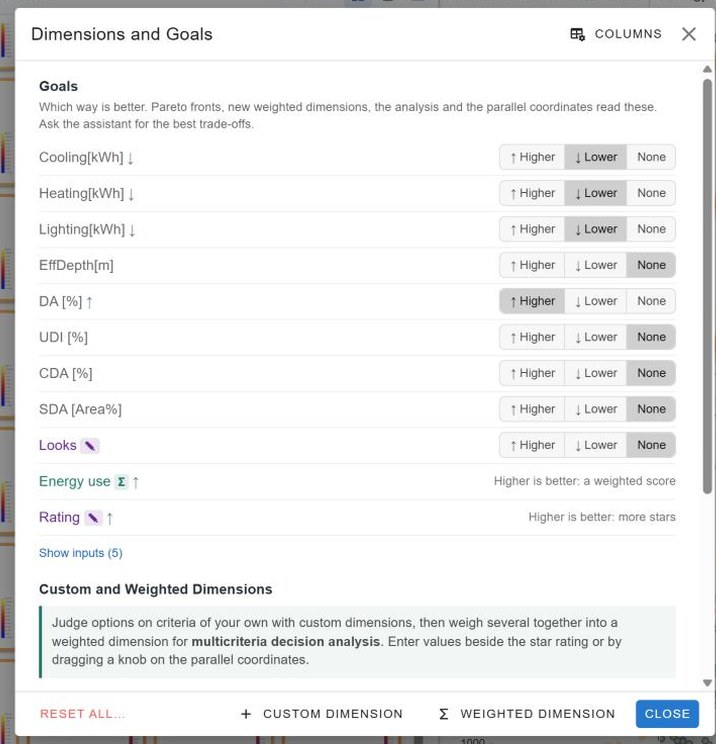

Open **Dimensions** and set a goal for each output, such as lower cooling or higher daylight. Arrows on every axis then show the better direction, and the methods below use the goals to tell which options are better. Columns named with `min:` or `max:` already have their goals set when you load them. [Open Dimensions](https://designsense.app/?open=dimensions)

*The Dimensions and Goals dialog. It shows the goal for each output, a custom dimension (Looks), a weighted dimension (Energy use) and the star rating.*

### Compare as you go

Do not save comparison for the end, when you already have your finalists. Comparing two or three options early helps you find out what you like about each of them and which criteria you actually care about. You can then use what you learn to adjust your goals and filters, or to add criteria.

**Compare** takes up to eight options from the shortlist, the selection or a saved set. It puts their measured values, your own dimensions, your ratings and your notes into one table. Rows where every option has the same value are dimmed, and the highest and lowest value in each row are marked.

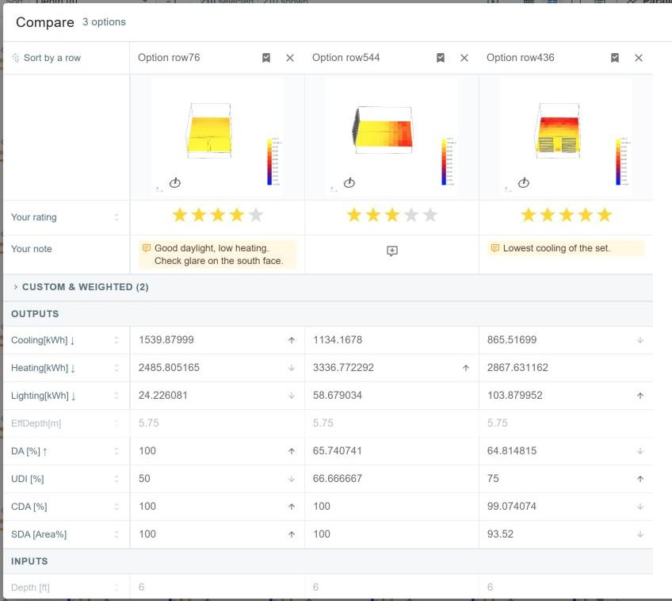

*The three shortlisted options in Compare. Ratings and notes are at the top, above the measured values, and arrows mark the highest and lowest value in each row.*

### Find the best trade-offs

The best trade-offs are the options that no other option beats on every goal at once. Together they are called the Pareto front. For any option that is not on the front, there is another option that is at least as good on every goal. You can therefore set it aside without having to decide how much one goal is worth compared with another.

- **When to use it.** Use it when you cannot, or do not yet want to, put numbers on how the goals trade against each other.
- **What it does not do.** It does not choose between the options on the front. The more goals you have, the more options end up on the front.
- **Where to find it.** The scatterplot marks the front for the two dimensions it shows. For the front across all goals, ask the assistant for *the best trade-offs*, or in Expert use **Analysis ▸ Keep the best trade-offs**.

### Score the options

A **weighted dimension** combines several criteria into one score. DesignSense scales each measured column from 0 to 1 between its lowest and highest value in the study, and reverses the scale when lower is better. It then multiplies each scaled value by the weight you give that criterion and adds the results. The score becomes an axis like any other. You can sort and colour by it, but you cannot filter by it. An option that is missing a value for any of the criteria gets no score.

The criteria do not all have to be measured. You can also give a weight to a custom dimension that you fill in by hand, such as form, aesthetics or how well the design fits the street, and to your star ratings. Subjective criteria like these then count towards the score with an explicit weight that other people can see and question. Otherwise they tend to influence the decision anyway, but without anyone stating how much. DesignSense scales a custom dimension by the range you gave it (for example 0 to 10), and not by the values in the study. Fill in a value for every option you want scored, because an option with a blank gets no score.

This kind of score is the value function of the Design Space Construction framework ([Haymaker et al., 2018](https://www.itcon.org/2018/8)). The framework also gives guidance on using it well:

1. **Agree on the goals before the weights.** Decide who is affected, who makes the decision, and how each goal is measured. The score can only reflect the goals you include.
2. **Keep hard requirements out of the score.** A limit that must be met is a constraint, so apply it as a filter. Use weights only for goals that can be traded against one another.
3. **Base the weights on people's priorities.** Each weight is a share of 100%. It states how much that goal should count for the people the decision affects.
4. **Try more than one weighting.** The paper notes that alternatives "may rank differently depending on the set of preferences used for evaluation". Make a weighted dimension for each stakeholder, or for each view of the priorities, and check whether the same options stay near the top. If they do, the choice is robust. If they do not, you have found a disagreement that the group needs to discuss.
5. **Do not rely on the score alone.** The score ranks the options but does not tell you why one ranks above another. Inspect the top options in the charts and the gallery to see what trade-off each one makes. Expect to go back and change the goals and weights as you learn more.

The example below scores the same six options under several weightings.

<!-- live: weights -->
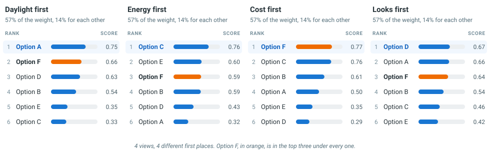

*Six made-up options scored on three measured criteria (daylight, cooling and cost) and one judged by hand (looks). The ranking changes with the weights. An option that stays near the top under every weighting is a robust choice.*

Weighted scoring is a reasonable method when:

- several goals conflict,
- there are too many options to compare by eye,
- the goals are agreed and every option has a value for each of them, and
- the people involved can say how much each goal matters.

It is less suitable when:

- a poor result on one criterion cannot be made up for by a good result on another,
- only a few options are left, in which case you can compare them directly, or
- people still disagree about the priorities. In that case, use it to explore the disagreement, not to settle it.

Remember that the score is relative. Each measured criterion is scaled against the options you generated, so a high score means good compared with those options, and not necessarily good in absolute terms.

### Add your own judgement

Some of what matters will not be in the data. DesignSense gives you three ways to add it:

- A **custom dimension** holds a value that you enter by hand for each option, for example for buildability, for how well it fits the street, or for the client's reaction.
- **Star ratings** record how much you like an option. They become an axis that you can filter by.
- A **note** records your reasons, for example *four stars, but check glare on the south face*.

You can give custom dimensions and ratings a weight in a [weighted dimension](#score-the-options), just like measured columns, so that measured and judged criteria count in the same score.

## Share

*Share your results with others to support the decision.*

All of the options below are in the **Share** menu in the toolbar. [Tour this task](https://designsense.app/?tour=share)

| You want to share | Use | What the other person gets |
| --- | --- | --- |
| The reasoning, step by step | **Capture this view**, then **The story** | Each capture saves the current view with its filters, goals and shortlist, plus a note that you write. You can present the captures in a meeting or download them as a PDF report |
| One picture of the outcome | **Summary image** | A single image that shows the options on your shortlist, in your selection or in a saved set, with findings that you can edit. Copy it into a slide or an email, or download it as a PNG |
| The remaining options, as data | **Download (.csv)** | A table of the options that pass your filters or are in your selection. It includes the picture and model columns, your ratings, your custom and weighted dimensions, and your notes, so you can load it into DesignSense again as a smaller study |
| The whole study, to explore | **Link to this dataset** | A link that opens the same data in DesignSense |

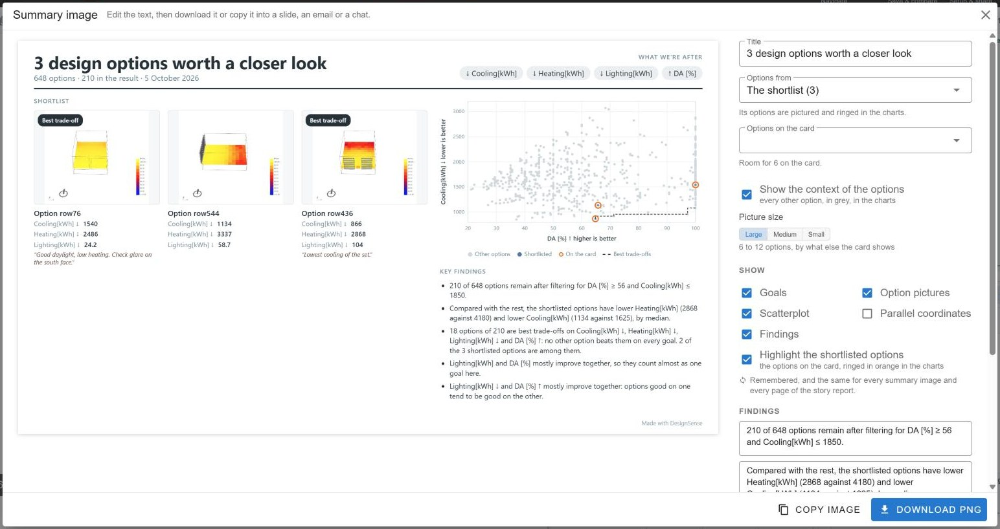

*The summary image for the shortlist. It shows the shortlisted options, how they compare with the rest, and findings that you can edit before you copy or download it.*

Two things to know about the link:

- The link contains **only the dataset**. Your filters, sets, shortlist, ratings and notes stay in your browser. To share those, send the CSV, the summary image or the report.
- You can only get a link for a study that you opened from a link. A study opened from your computer has no address to share, so [put it on GitHub](#load) first.

**What DesignSense saves.** For each study, DesignSense saves your sets, shortlist, ratings, notes, custom and weighted dimensions, goals, column choices and story in your browser. They are restored when you open the same study again in the same browser. Filters are not saved between visits. To delete saved work, use **Help ▸ Clear data**.

## The research

DesignSense was developed through a design study with practitioners in the built environment.

**[Designing with sense: A critical review and proposal for enhanced design space exploration in generative design](https://journals.sagepub.com/doi/10.1177/14780771241260854)**<br>
[Ahmed M. Abuzuraiq](https://abuzreq.com/) and [Halil Erhan](https://www.sfu.ca/~herhan/) · International Journal of Architectural Computing, 2024

<details>
<summary>Abstract</summary>

Designers in the built-environment disciplines increasingly solve problems using generative design methods, which promise novel and performant solutions to design problems but produce large design spaces that are challenging to explore. Design Space Exploration (DSE) interfaces have been used to understand, refine and narrow design spaces. Still, a critical analysis of current DSE interfaces shows a gap between their features and how designers explore and make decisions. We conducted a design study with domain experts to develop a DSE interface (DesignSense) that tightly integrates and adds to several features found separately in current DSE systems. We present a formative focus group evaluation, which suggested more areas for improvement and highlighted the need to distinguish designers from scientists as two user groups of DSE systems with varying needs, amongst other findings.

</details>

DesignSense is a research project and is still changing. We welcome feedback: use **Help ▸ Send feedback** in the app, or [open an issue](https://github.com/abuzreq/DesignSense/issues). The code is released under the [MIT licence](https://github.com/abuzreq/DesignSense/blob/master/LICENSE).
