# DesignSense: from a design space to a decision

DesignSense shows a table of generated design options, with their pictures and 3D models, as a set of linked views. You use it for four tasks: understanding the design space, narrowing it down, deciding between the options that are left, and sharing the result.

**[Open DesignSense](https://designsense.app/)** · [Watch the one-minute intro](https://youtu.be/4A_yEZ4cex4) · [Source on GitHub](https://github.com/abuzreq/DesignSense) · [The paper](https://journals.sagepub.com/doi/10.1177/14780771241260854)

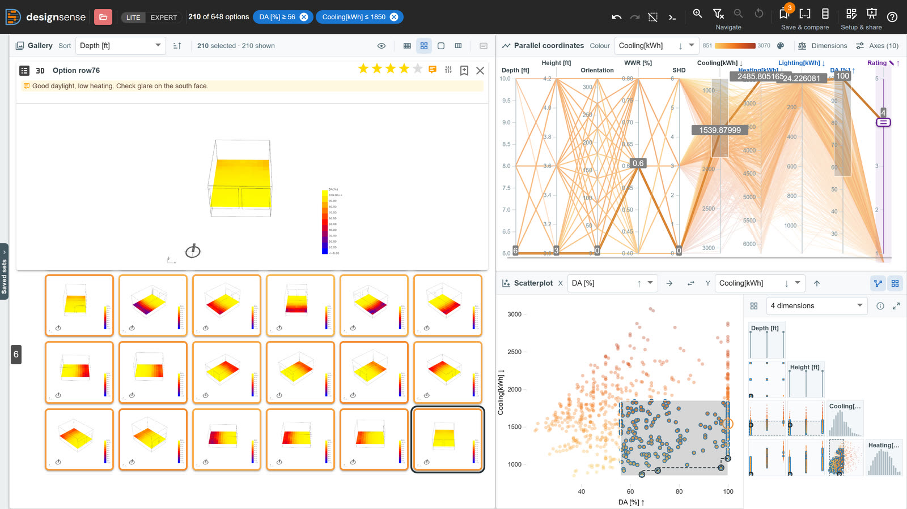

*The Windows study from Design Explorer: 648 window designs, narrowed to 210 by the two filters in the bar. Arrows on the axes show which way is better for each output. The inspected option has a rating and a note.*

This guide follows one study from start to finish. It covers how the data is made, what the files look like and how to load them, then each of the four tasks, and finally what Expert mode adds.

<!-- contents -->
- Start here
  - [The process at a glance](#the-process-at-a-glance)
- Getting the data in
  - [Generate](#generate)
  - [Prepare](#prepare)
  - [Load](#load)
- Finding your way
  - [Look around](#look-around)
- The four tasks
  - [Understand](#understand)
  - [Narrow](#narrow)
  - [Decide](#decide)
  - [Share](#share)
- Going further
  - [Expert mode](#expert-mode)
- About
  - [The research](#the-research)

> [!TIP]
> **New here?** The welcome screen plays a one-minute intro. The app also has a guided tour that takes a few minutes: it uses a small sample dataset and goes through the four tasks, pointing at each view and control as it goes. Start it from the welcome screen, or from **Help ▸ Take the tour** at any time. [Take the tour](https://designsense.app/?tour=start)
>
> If you would rather watch, the [full tutorial](https://youtu.be/KHVPWmzlfpQ) (8 minutes) goes through the same steps.

## The process at a glance

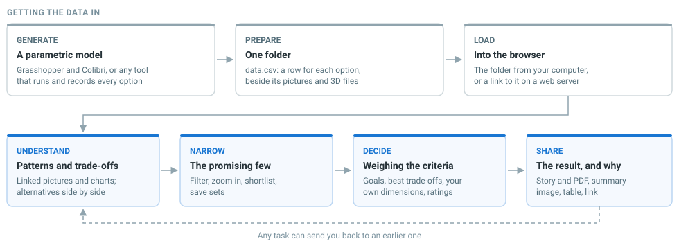

| Stage | What happens | Where |
| --- | --- | --- |
| [Generate](#generate) | A parametric model is run for every combination of its inputs, or for the combinations an optimiser picks, and each run is recorded | Grasshopper with Colibri, Galapagos or Octopus, or any tool of your own |
| [Prepare](#prepare) | The runs are stored in one folder: `data.csv`, a picture of each option, and optionally a 3D model of each | Your computer |
| [Load](#load) | You open the folder from your computer, or from a link once it is on a web server or in a shared Google Drive folder | DesignSense |
| [Understand](#understand) | Find the patterns, relationships and trade-offs in the design space, and work out which criteria matter | DesignSense: the [linked views](#look-around) |
| [Narrow](#narrow) | Find the options that meet those criteria, and set promising ones aside | DesignSense: filters, shortlist, saved sets |
| [Decide](#decide) | Choose, weighing measured and judged criteria together | DesignSense: goals, Compare, best trade-offs, weighted scores, your own criteria |
| [Share](#share) | Give other people the result and the reasoning behind it | DesignSense: story, summary image, table, link |

The first three stages get the data into DesignSense. The other four are the tasks themselves. You will move back and forth between them, because what you learn in one often sends you back to an earlier one.

DesignSense does not upload your data. It is read in your browser, and your work (saved sets, shortlist, ratings, notes) is kept in that browser too.

## Generate

A study is a table with **one row for each design option**. Its columns are the inputs that produced the option, such as a width, a glazing ratio or an orientation, and the outputs that were measured or simulated for it, such as cost, daylight or cooling load. Each option can also have a picture and a 3D model, stored as files next to the table.

DesignSense reads the format that [Design Explorer](https://tt-acm.github.io/DesignExplorer/) introduced, so any tool that makes a study for Design Explorer also makes one for DesignSense.

<!-- tabs -->

### With Grasshopper: Colibri

**Colibri** is a free set of Grasshopper components by [CORE studio at Thornton Tomasetti](https://www.thorntontomasetti.com/core-studio), the makers of [TT Toolbox](https://www.food4rhino.com/en/app/tt-toolbox). It steps your sliders through every combination of values. After each step it waits for the definition to recompute, then records the inputs, the outputs and a picture of the result.

Download [Colibri from Food4Rhino](https://www.food4rhino.com/en/app/colibri) (Rhino 7 and 8). Once installed, it appears under the TTToolbox tab in Grasshopper. It has four components:

| Component | What it does |
| --- | --- |
| **Colibri Inputs** (the Iterator) | Takes sliders, value lists and panels, and steps through every combination of their values, or a subset that you choose |
| **Colibri Outputs** | Collects the values you want to record for each iteration, such as areas, costs or simulation results |
| **Colibri Aggregator** | Combines the inputs and outputs of every iteration into one dataset and writes it to a folder. It can also save a preview image of each iteration |
| **Colibri Image Settings** | Sets the size of the preview image, or records several views per iteration |

To set it up, connect the sliders that define your design space to Colibri Inputs, and the results you want to compare to Colibri Outputs. Connect both to the Aggregator and run it. The number of runs grows quickly (five sliders with six steps each make 7,776 runs), so start with coarse steps.

Colibri writes **a folder** (`C:\Colibri` by default) with `data.csv` and one image per iteration. That folder is your study. [Prepare](#prepare) describes what is in it, and [Load](#load) explains how to open it.

> [!NOTE]
> **Coming from Design Explorer?** Design Explorer had you upload the Colibri folder to Google Drive and paste its link. That works in DesignSense too, at designsense.app: share the folder so anyone with the link can view it, and paste its link. You can also open the folder from your computer, or put it on a web server such as a GitHub repository. [Load](#load) covers all three.

### With Grasshopper: an optimiser

You do not have to run every combination. When there are too many, an optimiser can sample the design space for you. It tries some options, looks at the results, and spends its remaining runs where the results are better.

- **Galapagos**, which comes with Grasshopper, searches for the best value of a single objective.
- **[Octopus](https://www.food4rhino.com/en/app/octopus)**, a plugin, works with several objectives at once and searches for the best trade-offs between them.

To turn a run of either into a study, record every option the solver tries, with its picture, as a row of `data.csv`. Recording only the final results is not enough. People have used Colibri's Aggregator for this, letting the solver move the sliders in place of Colibri Inputs. Check that it records each run in the version you have.

An optimiser does not sample evenly. Most of its options sit close to the good results it found, and few are anywhere else. The charts therefore show where the solver searched, and a relationship between an input and an output is less reliable than in an even sweep.

That is fine for [Narrow](#narrow) and [Decide](#decide), where you mainly need the good options. For [Understand](#understand), an even sweep works better, even a coarse one. You can also combine the two: run a coarse sweep first, then use an optimiser to add options in the region you want to look at more closely.

### With anything else

The format does not depend on Grasshopper. A Python script, a Dynamo graph, an optimisation run or a spreadsheet works just as well, as long as it produces a CSV with one row per option. Pictures are optional: without them the gallery shows cards with no picture, and the charts work as usual.

<!-- /tabs -->

### 3D models

3D models are optional. DesignSense shows `.glb`, `.gltf` and `.obj` files, and the `.json` scenes that Design Explorer uses.

- **A Design Explorer study** with a `threeD` column of `.json` scenes loads as it is.
- **Rhino 8**: select the geometry, choose *File ▸ Export Selected*, and pick glTF from the file-type list.
- **Rhino 7**: install McNeel's glTF exporter from the Package Manager. Or export *Wavefront (.obj)* and tick *Map Rhino Z to OBJ Y*, so that the model stands upright.
- **Grasshopper**: bake the geometry into Rhino, then export it as above. Export one file per option, and give it the same name as that option's image.

A `.glb` is the safest choice, because it is one self-contained file. Add a `model3d` column to `data.csv` that holds each option's file name.

In the app, a model loads only when you ask for it: the inspector's 3D view shows a **Load 3D model** button first. Inspecting another option unloads the model and shows that option's button.

## Prepare

A study is one folder:

```
my-study/
├── data.csv          one row per option
├── 0001.png          the picture the row names
├── 0001_2.png        a second view of the same option (optional)
├── 0001.glb          its 3D model (optional)
├── 0002.png
└── …
```

`data.csv` starts with a header row, followed by one row per option. This header comes from one of Design Explorer's own studies, which loads without changes:

```
in:Depth,in:Height,in:Orientation,in:WWR,in:SHD,out:Cooling[kWh],out:Heating[kWh],out:Lighting[kWh],out:DA,img,threeD
```

### What the column names mean

DesignSense works out what a column is from its name. The prefix is not shown in the interface.

| Column | Read as | Example |
| --- | --- | --- |
| `in:` | An input: a parameter of the design | `in:width` |
| `out:` | An output: something measured or simulated | `out:cost` |
| `min:` | An output where lower is better | `min:cost` |
| `max:` | An output where higher is better | `max:daylight` |
| `name:` | The name shown for each option, in place of "Option 12". A column called `Name`, `Description`, `Label` or `Title` also works | `name:variant` |
| `ID` | The option's identifier. Without this column, the rows are numbered | `ID` |
| `img` or `image` | The option's picture | `img` |
| `img_2`, `img_3` … | Further views of the same option, in that order | `img_2` |
| `model3d`, `3d` or `threeD` | The option's 3D model. Use `model3d_2` and so on for more | `model3d` |
| `custom:` | A dimension whose values you enter by hand in DesignSense | `custom:looks` |
| `weighted:` | A weighted sum of other dimensions, made in DesignSense | `weighted:score` |
| anything else | A plain dimension | `floors` |

Names are not case-sensitive. Colibri writes `in:` and `out:`. `min:` and `max:` are DesignSense's own, and you can set the same goals after loading without editing the file. DesignSense writes `custom:` and `weighted:` columns itself when you [download a table](#share), so your own criteria come back when you load that table again.

### What the cells hold

- **Numbers** become axes that you can filter, sort and colour by. A column counts as numeric when every filled cell in it is a number.
- **Text** shows in the inspector, on the gallery cards and in Compare, and you can sort and colour by it. It does not become an axis.
- **Empty cells** are missing values, not zero.
- **Picture and model cells** hold either a file name (`0001.png`), which DesignSense looks for next to `data.csv`, or a full link (`https://…/0001.png`). Pictures can be `.png`, `.jpg`, `.gif`, `.webp`, `.bmp` or `.svg`.
- Commas, tabs and semicolons all work as separators.

> [!WARNING]
> A column called `image_url` or `picture` is **not** read as a picture. Rename it to `img`.

### Coming from Design Explorer

- `in:`, `out:` and `img` mean the same thing, so a Colibri folder loads as it is.
- The `threeD` column and its `.json` scenes are read.
- A `Description` column, which Design Explorer's samples use, provides the option names.
- A settings file in the folder is ignored. You set goals, colours and the layout in DesignSense.
- A Google Drive folder link works at designsense.app, as it did in Design Explorer. See [From a link](#from-a-link).

## Load

**Load data** is in the toolbar and on the welcome screen. Its dialog gives you three ways to open a study. [Open Load data](https://designsense.app/?open=load)

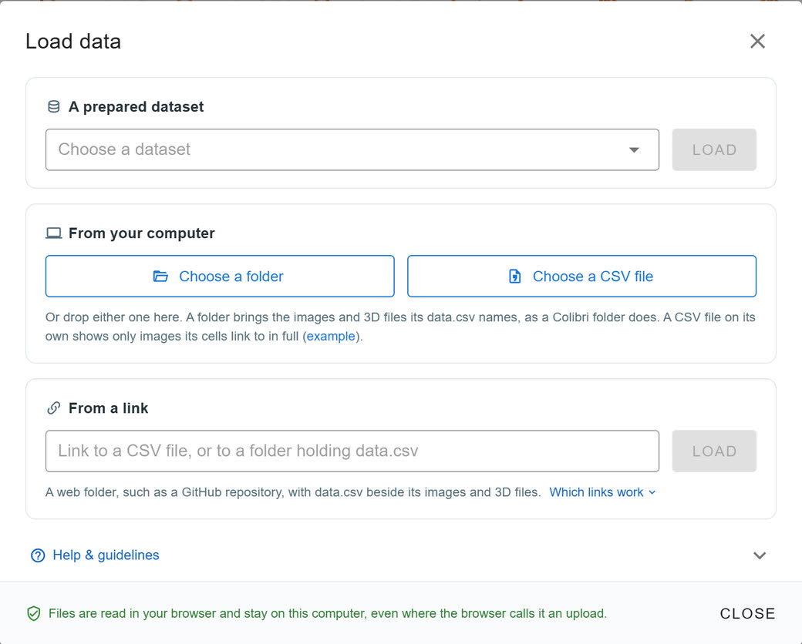

*The Load data dialog: a prepared dataset, a folder or CSV file from your computer, or a link. Help & guidelines folds away the notes on columns, picture names and 3D exports.*

<!-- tabs -->

### A prepared dataset

DesignSense comes with ten sample studies, including three of Design Explorer's own. The list starts with the richest: used cars from Craigslist, then Windows Exploration, the AIA building, a rezoning project, a solar study, a massing study and a façade study. Loading one is the quickest way to see what a study looks like in the app.

### From your computer

- **Choose a folder**, or drop one onto the dialog. DesignSense finds `data.csv` in it, with the pictures and 3D files the table names. Use this to open a Colibri folder straight from where Colibri wrote it.
- **Choose a CSV file** on its own, or drop one, to load just the table. Pictures then show only where a cell holds a full link.

Your browser may ask you to confirm an "upload". Despite the word, the files are read on your computer and are not sent anywhere.

A study that you open from your computer has no link, so you cannot [share the dataset itself](#share). To do that, put the study online and load it from a link.

### From a link

Paste a link to a CSV file, or to a folder that holds `data.csv`. **Which links work**, under the box, sums up this table.

| The link | What DesignSense does |
| --- | --- |
| Ends in `.csv`, `.tsv` or `.txt` | Reads that file, and looks for the files it names in the same place |
| A file page on github.com | Reads the raw file behind the page |
| Anything else | Treats it as a folder and reads `data.csv` inside it |
| A Google Drive folder | Reads `data.csv` and the pictures and models beside it, when the folder is shared so anyone with the link can view it. This works at designsense.app; a copy you build yourself needs a Google API key, which the README explains |
| A OneDrive folder | Works for some accounts only. Microsoft blocks the rest |

**Putting a study on GitHub** is the simplest way to get a link that works for everyone:

1. Create a public repository and upload the whole folder: `data.csv`, the pictures and the models.
2. Open `data.csv` on GitHub and copy the address of the page.
3. Paste it under *From a link* and press Load.

Any other web server works the same way, provided it lets other sites read its files.

<!-- /tabs -->

### Checking how the columns were read

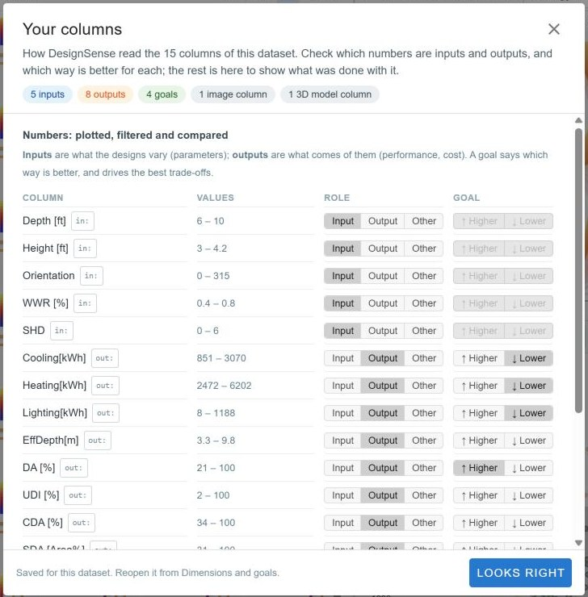

The first time you load a study of your own, the **Your columns** dialog shows how DesignSense read each column. You can change a column to an input, an output or neither, set which direction is better for an output, and choose the column that names the options. DesignSense remembers these choices for that study.

*Your columns for the Windows study: five inputs and eight outputs, four of them with a goal, plus the columns that hold the pictures and the 3D models.*

### When a load goes wrong

| The message | What to do |
| --- | --- |
| "No data.csv was found in that folder." | Check the link, or link to the CSV file itself. In a folder from your computer, the table must be a `.csv` file |
| "That link opened a web page, not a CSV file." | On GitHub, open the file itself, not the folder or the repository |
| "… denied access." or "Couldn't reach …" | The files are not public, or the server does not let other sites read them. Files on GitHub can be read |
| "This copy of DesignSense can't read Google Drive folders" | You are on a copy built without a Google API key. Use designsense.app, or download the folder and choose it from your computer |
| "Google Drive denied access to that folder." | Share the folder so anyone with the link can view it, then load it again |
| "Each column needs its own name …" | Two columns have the same header. Rename one of them |
| "N image or model files named in the data could not be found." | If you opened the CSV on its own, choose its folder instead. Otherwise the names in the `img` column do not match the files: check the spelling and the extension |
| The pictures are missing, with no message | Rename the picture column to `img` |

## Look around

All the views show the same options and stay in step: when you filter, select or inspect in one view, the others follow. **Help ▸ Take the tour** shows each view in turn in the app.

| View | What it shows |
| --- | --- |
| **Gallery** | A picture of every option, in frames of one size. Sort by any column, and pick a size from small to extra large. **Show details** adds a **Values** row to each card (see below) |
| **Inspector** | One option in detail: its picture at full size, its other views, its 3D model and its values. Click a picture, a line or a dot to inspect that option |
| **Parallel coordinates** | Each axis is a dimension and each line is an option, so one line shows all of an option's values |
| **Scatterplot** | Each dot is an option, placed by two dimensions you choose. The **Overview** beside it shows every pair of dimensions at once, and moves under the plot when the panel is taller than it is wide |
| **Saved sets** | Your shortlist and saved sets, in a drawer at the left edge. Rest the pointer on the edge to open it, or pin it to keep it beside the panels |

**Reading values across the gallery.** With **Show details** on, open **Values** on any card and the whole row opens, so you can read one value across several options. The rows line up from card to card and scroll together. The first eight values are the ones that matter most: dimensions with a goal, then outputs, then inputs. The picker next to the button chooses others, and its top sets the text size.

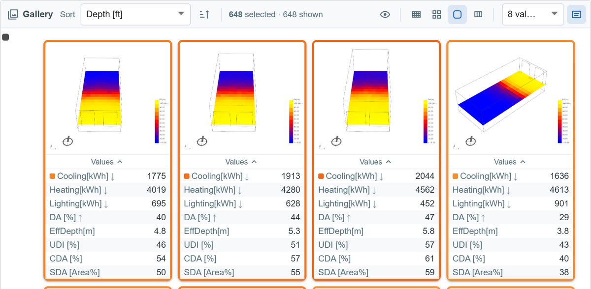

*A row of the Windows study with its values open. Arrows mark the goals, and the swatch marks the colour dimension, which is also each card's border.*

**Colour.** You choose one column to colour by, and every view uses it: the lines, the dots and the border of each gallery card. Click an axis title to colour by that dimension, and pick a palette from the menu beside the colour key. Four other colours are fixed and always mean the same thing:

| Colour | Meaning |
| --- | --- |
| Blue | Selected: the options that pass your filters, or are in your selection |
| Dark | Inspected: the option shown in the inspector |
| Orange | On the shortlist |
| Bright blue outline | Keyboard focus |

**Quick actions.** Right-click anywhere in the workspace for the actions you use most, in a ring around the pointer: stop inspecting, shortlist the result, clear the filters, save a set, zoom in, exclude, and undo.

**Text size.** The welcome screen sets how large the interface's text is: Default, Large, Larger or Largest, up to half again as large. Every label, chart and dialog follows it, and the choice is kept in this browser. Exported images and reports keep their own fixed sizes.

**Lite and Expert.** DesignSense starts in Lite mode, where you narrow the options with filters. Expert mode, switched on in the toolbar, builds a selection step by step instead and adds tools of its own; [Expert mode](#expert-mode) explains the difference. Everything before that page works in Lite.

The next four sections cover the four tasks. You will rarely do them once and in order: what you learn while deciding may send you back to narrow in a different way, and sharing a result often starts another round. The examples all use the 648 window designs shown at the top of this guide. Imagine an architect who has to choose a few of them to show a client.

## Understand

*Find the patterns, relationships and performance trade-offs in the design space. Compare alternatives and weigh their strengths and weaknesses to learn which criteria matter.*

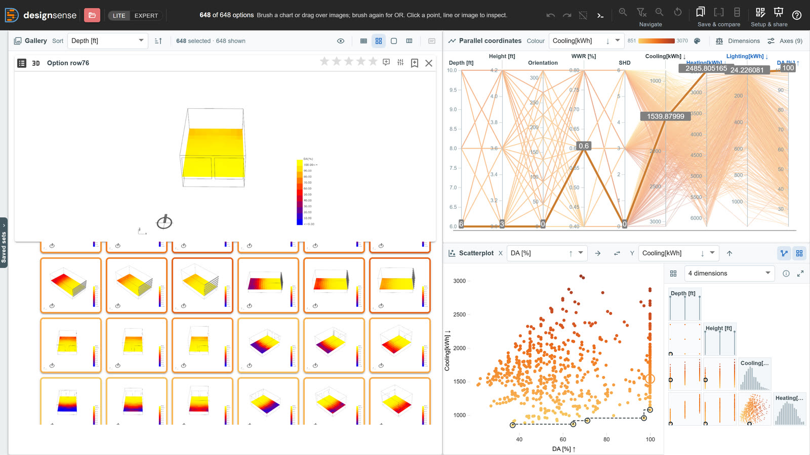

*All 648 options, coloured by cooling. One option is inspected, so its picture is open on the left and its line is drawn thicker across the axes, with its values. In the scatterplot, the dashed line connects the best trade-offs between daylight (DA) and cooling. The overview beside it shows the other pairs.*

**Try it:** [Open the Windows study](https://designsense.app/?sample=windows) · [Tour this task](https://designsense.app/?tour=understand) · [Watch this part](https://youtu.be/KHVPWmzlfpQ?t=45)

- **Patterns.** The lines in the parallel coordinates show where options are concentrated and where there are few. Drag an axis title to put two axes next to each other. If the lines between them run roughly level, the two dimensions rise together. If they cross, one goes up as the other goes down.
- **Relationships.** The scatterplot shows one pair of dimensions in detail. The Overview shows every pair at once, so you can spot the pairs worth a closer look; click one to plot it. Colour by a third dimension to see what else changes with them.
- **Trade-offs.** Once each output has a [goal](#decide), arrows on every axis show which direction is better, and the scatterplot draws a line through the best trade-offs for the pair it shows.
- **Form and performance together.** Sort the gallery by a column to see how the designs change as that value changes. When you inspect an option, its line and its dot are highlighted in the charts, so you read its performance next to its form: low cooling and good daylight, for example, but more heating.
- **Strengths and weaknesses.** **Compare** shows up to eight options side by side, and marks where they differ. See [Compare as you go](#compare-as-you-go).
- **New criteria.** Looking at alternatives often brings up criteria that are not in the data. You might notice, for example, that the deep-set windows on the south face look right. Record an observation like this as a note on the option. [Decide](#decide) explains how to turn it into a dimension of its own.

The example below shows how four common patterns look in the parallel coordinates and in the scatterplot, using the same options for both.

<!-- live: patterns -->
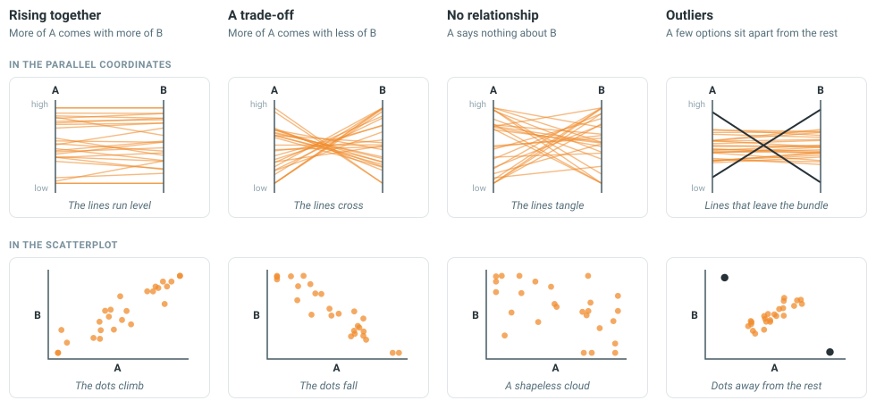

*Two dimensions, A and B. An axis without a goal has its low values at the bottom, as drawn here. An axis with a goal has its better values at the top. When both axes have goals, level lines therefore mean that the two goals improve together, and crossing lines mean that they conflict.*

Expert mode adds two more aids: **clusters**, which group similar options and show one picture for each group, and **Analysis**, which reports the spread of every dimension, the outliers, and which inputs affect which outputs. See [Expert mode](#expert-mode).

### The overview, expanded

The **expand** button on the Overview opens it over most of the window, with axes on every row and column. It is the same overview, so what you choose there shows beside the scatterplot too.

- **Choose and order the dimensions.** Pick up to ten, and drag a name on the diagonal onto another to move it there. The small overview shows the first six.
- **Brush on it.** Drag over a plot or a histogram to filter, and again for another range (OR). Click inside a range to remove it, or the × in a cell's corner to clear all of its ranges.
- **Read the spread.** Each histogram shows the selected options in blue over the rest. Point at a bar to read its range and count.
- **Pick a pair.** Click a plot to show that pair in the scatterplot.

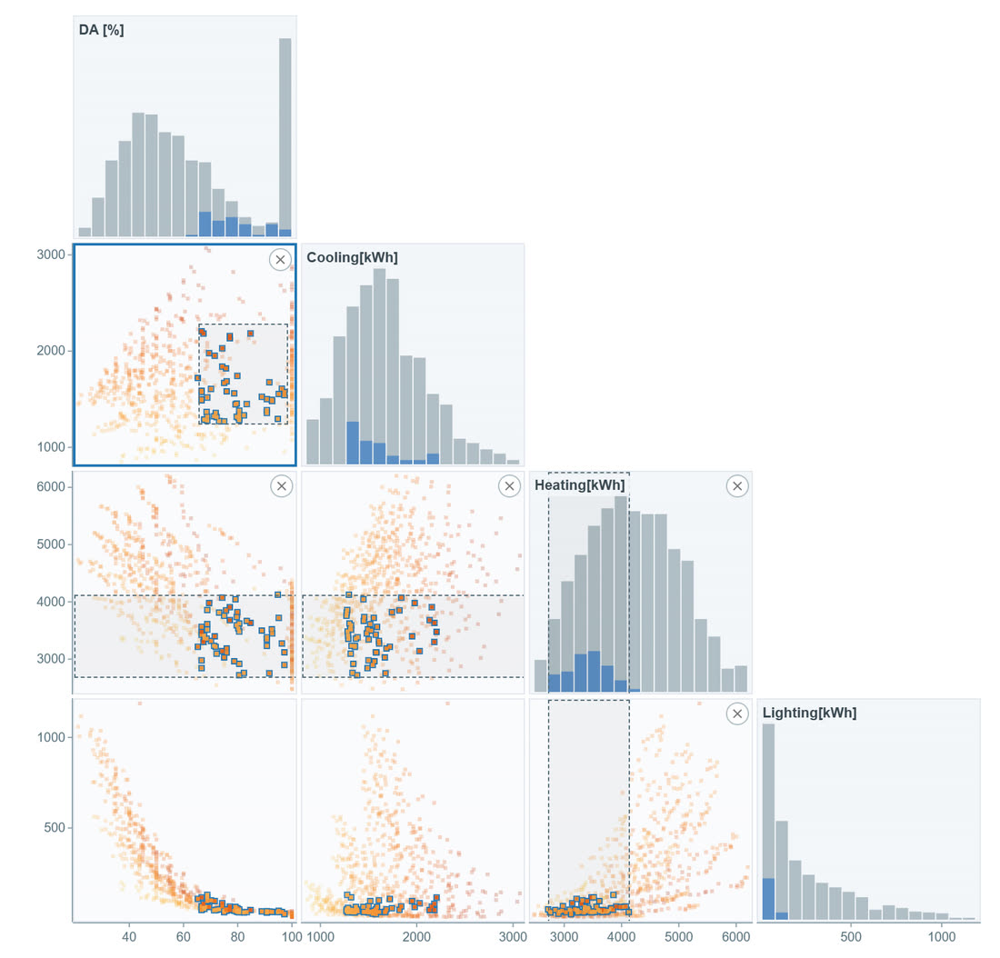

*Daylight, cooling, heating and lighting. A box on the daylight–cooling plot and a range on the heating histogram filter the options, and the plots and histograms show the selected ones in blue.*

## Narrow

*Look for the alternatives that satisfy your criteria, including criteria that emerge along the way. An alternative is a proposal and not merely a data point, so even an option that performs poorly can lead to a better one. The options you select are not final either. You refine them, or use them to guide the next round of exploration.*

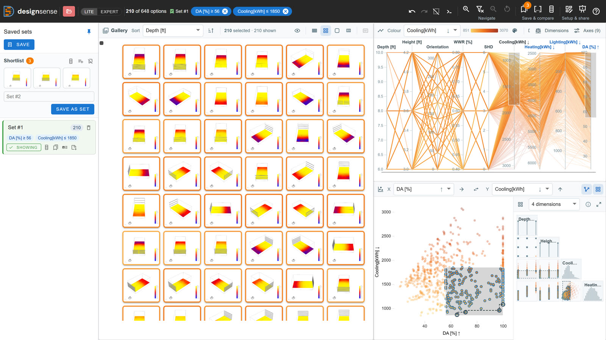

*Two filters, daylight of at least 56% and cooling of at most 1,850 kWh, leave 210 of the 648 options, and the charts highlight them. Saved sets is pinned on the left, with a shortlist of three options and the set saved from these filters.*

**Try it:** [Open the Windows study](https://designsense.app/?sample=windows) · [Tour this task](https://designsense.app/?tour=narrow) · [Watch this part](https://youtu.be/KHVPWmzlfpQ?t=131)

- **Filter.** Drag along an axis in the parallel coordinates, or drag a box in the scatterplot or the expanded overview. Each filter appears as a chip in the bar at the top, next to a count of the options that are left. Remove a chip to remove its filter. Undo and redo step through your changes.
- **Pick by eye.** Drag a box over pictures in the gallery to keep only those options. Or point at a picture and use its **−** to leave that option out, and **+** to bring it back. This lets you narrow by what the designs look like, as well as by their numbers.
- **Ask.** Type a request into the assistant's box in the toolbar, such as *cooling under 1850* or *what do these have in common*. The assistant applies it or answers the question. It runs in your browser. Press `/` to jump to it.
- **Go deeper.** **Zoom in** makes the remaining options the whole collection: the charts rescale to fit them, and you can filter again within them. **Exclude** does the opposite and removes those options. **Step back** undoes the last zoom or exclusion, and **Reset** restores the full collection.
- **Keep proposals aside.** Click the bookmark on a card to put that option on the **shortlist**. The shortlist is not affected by filtering or zooming, so an option that fails a filter but still interests you stays there while you keep looking.
- **Save where you are.** **Save** in Saved sets keeps the current options as a set. See [Saved sets](#saved-sets) below.
- **Start the next round.** You can load the table you [download](#share) as a smaller study of its own. The input values of the options you kept also tell you where to rerun the parametric model in finer steps.

### Saved sets

A saved set keeps a point you may want to come back to, or a direction to compare with others.

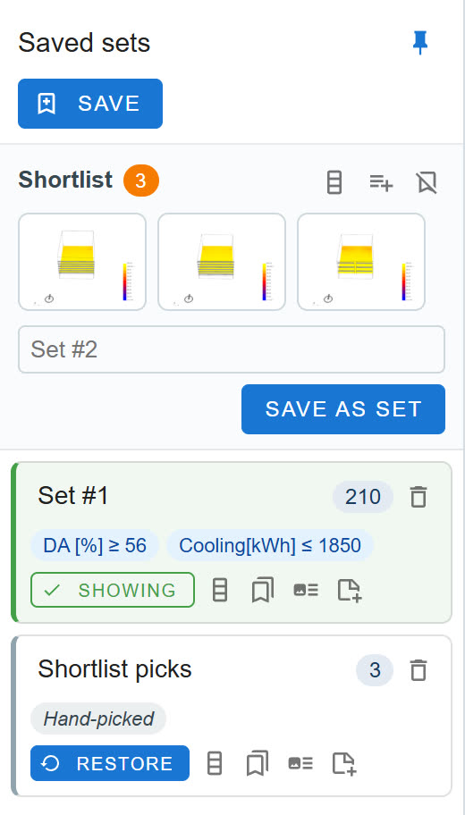

- **Save** keeps the options that pass your filters, together with the filters themselves. The set's chips list those filters.
- **Restore** brings a set's filters back. Undo brings yours back again. While the current filters are the set's, its button reads **Showing**, and the set's name appears next to the count in the filter bar.
- A set saved from the shortlist (**Save as set**) holds exactly those options rather than filters, and is marked **Hand-picked**. Restoring it shows its options as one orange chip.
- Each set can be compared, put on the shortlist, turned into a [summary image](#share), and given a note.
- **Pin** the drawer to keep it beside the panels, which make room for it. Drag its right edge to resize it. Unpin it to return it to the edge.

*Saved sets, pinned. Set #1 was saved from the two filters, which are showing. Shortlist picks was saved from the shortlist, so it is hand-picked.*

### Filters in Lite, a selection in Expert

Lite and Expert narrow in different ways. The difference is how each new brush combines with the ones before it.

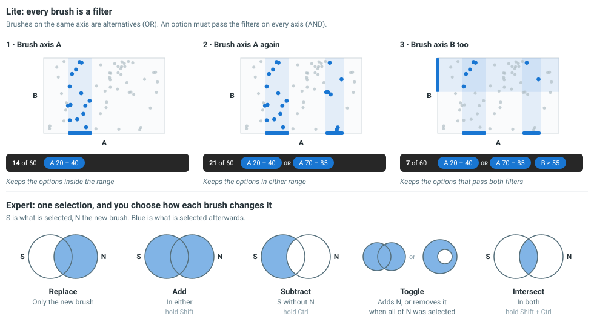

*Top: three brushes in Lite, with the filter bar after each one. Bottom: the five ways Expert can combine a new brush with the current selection.*

**In Lite, every brush is a filter, and filters always combine in the same way.**

- A second brush on the same axis adds an alternative range. An option passes if it is in either range (OR). A second box in the scatterplot works the same way.
- An option has to pass the filters on every axis (AND), so brushing another axis always leaves fewer options.
- Dragging an existing brush changes its filter rather than adding a new one.

This rule cannot express every combination. In return, your filters always read as a plain list of criteria, and the order in which you made them does not matter.

**In Expert there are no filters.** You have one selection, and you choose how each new brush changes it. That is covered in [Expert mode](#expert-mode).

### Read where you are

As you narrow, the filter bar at the top shows where you are in the design space.

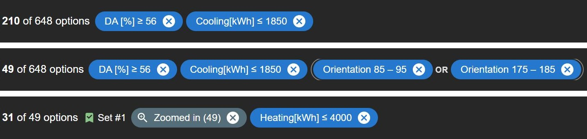

*The filter bar at three points in the Windows study.*

- **The count** shows how many options are left, here 210 of 648.
- **Each chip is one criterion.** Its colour says where it came from:
  - **blue** for a range or a box you dragged. It names the dimension and the range you kept, in the units of the data. A chip such as `≥ 56` comes from a brush that reaches the end of its axis;
  - **green** for options picked or left out by hand in the gallery;
  - **grey** for a zoom or an exclusion. In the bottom row, *Zoomed in (49)* means the collection is now those 49 options, and the count is out of 49. The chip's tooltip lists the criteria that were active when you zoomed;
  - **orange** for the options of a restored hand-picked set.
- **OR links two brushes on the same axis.** In the middle row, the orientation is either about 90 or about 180. Each of the two chips has its own ×.
- **Click the × on a chip** to remove that criterion. On a zoom, it zooms back out. Chips that do not fit wait under **+N**.
- **The name of a saved set** appears next to the count when the current filters are the ones saved in it.

You can read the bar from left to right as a sentence: daylight of at least 56%, and cooling of at most 1,850 kWh, and an orientation of about 90 or about 180. A description like this is easier to remember, and to explain to a colleague, than a list of 49 option numbers. It is also what DesignSense saves with a set and writes into the note of a captured view.

## Decide

*Combine objective and subjective criteria to make the final choice.*

Deciding is difficult. Goals conflict, the people involved weigh them differently, and some of what matters was never measured. No single method resolves all of this, so DesignSense offers several that you can use on their own or together. All of them start from the same step: saying what "better" means.

<!-- cards -->
- **[Compare as you go](#compare-as-you-go)**<br>Put options side by side to find out what you like about each one.
- **[Find the best trade-offs](#find-the-best-trade-offs)**<br>Set aside every option that another option beats on all the goals.
- **[Score the options](#score-the-options)**<br>Combine the goals into one number, and try more than one weighting.
- **[Add your own judgement](#add-your-own-judgement)**<br>Rate options, write notes, and add criteria that are not in the data.

**Try it:** [Tour this task](https://designsense.app/?tour=decide) · [Watch this part](https://youtu.be/KHVPWmzlfpQ?t=215)

### Say what better means

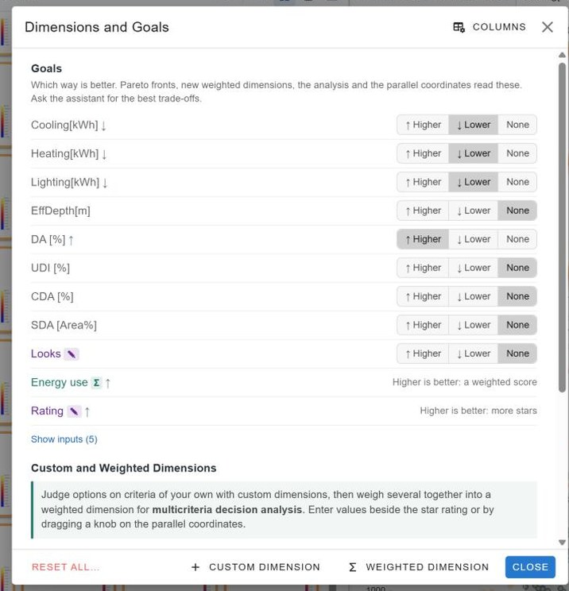

Open **Dimensions** and set a goal for each output, such as lower cooling or higher daylight. Arrows on every axis then show the better direction, and the methods below use the goals to tell which options are better. Columns named with `min:` or `max:` already have their goals when you load them. [Open Dimensions](https://designsense.app/?open=dimensions)

*The Dimensions and Goals dialog, with the goal for each output, a custom dimension (Looks), a weighted dimension (Energy use) and the star rating.*

### Compare as you go

Do not save comparing for the end, when you already have your finalists. Comparing two or three options early helps you find out what you like about each one, and which criteria you actually care about. You can then adjust your goals and filters, or add criteria.

**Compare** takes up to eight options from the shortlist, the selection or a saved set, and puts their values, your ratings and your notes in one table.

- **The rows follow the same order as everywhere else:** the goals first, then the other outputs, then the inputs, with text columns last in each group. Your own custom and weighted dimensions are folded under their own heading.
- **The pictures, ratings and notes stay at the top** while you scroll through the values, so you always know which column is which.
- **Differences stand out.** Rows where every option has the same value are dimmed, and the highest and lowest value in each row are marked.
- **Click a row's name** to sort the options by it.

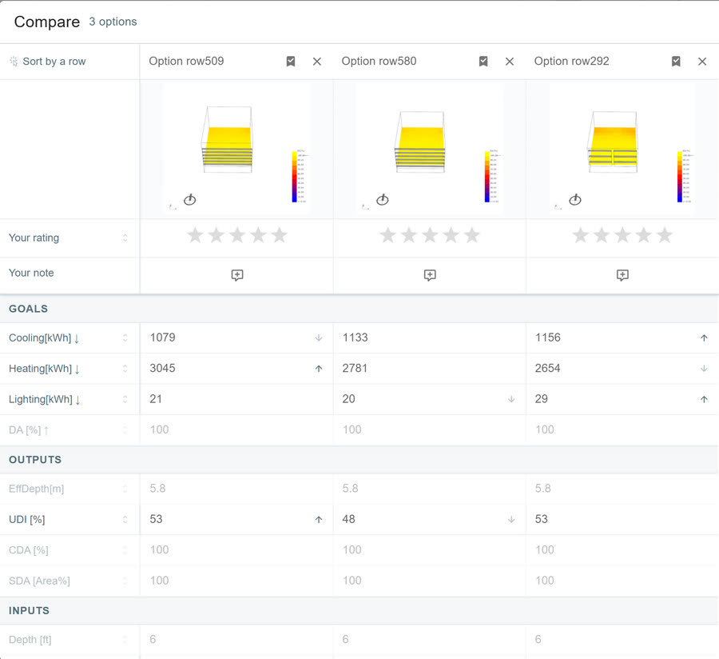

*The three shortlisted options in Compare. The goals come first, and arrows mark the highest and lowest value in each row.*

### Find the best trade-offs

The best trade-offs are the options that no other option beats on every goal at once. Together they are called the Pareto front. For any option that is not on the front, another option is at least as good on every goal. You can therefore set it aside without deciding how much one goal is worth against another.

- **When to use it.** When you cannot, or do not yet want to, put numbers on how the goals trade against each other.
- **What it does not do.** It does not choose between the options on the front. The more goals you have, the more options end up on the front.
- **Where to find it.** The scatterplot marks the front for the two dimensions it shows. For the front across all your goals, ask the assistant for *the best trade-offs*. In Expert, **Analysis ▸ Best trade-offs** also shows it, and lets you keep the options just behind the front too.

### Score the options

A **weighted dimension** combines several criteria into one score. DesignSense scales each measured column from 0 to 1, between its lowest and highest value in the study, and reverses the scale when lower is better. It then multiplies each scaled value by the weight you give that criterion, and adds the results.

The score becomes an axis like any other. You can sort and colour by it, but not filter by it. An option that is missing a value for any of the criteria gets no score.

The criteria do not all have to be measured. You can also weight a custom dimension that you fill in by hand, such as form, aesthetics or how well the design fits the street, and your star ratings. Subjective criteria then count towards the score with an explicit weight that other people can see and question. Otherwise they tend to influence the decision anyway, without anyone saying how much. DesignSense scales a custom dimension by the range you gave it (for example 0 to 10), not by the values in the study. Fill in a value for every option you want scored.

This kind of score is the value function of the Design Space Construction framework ([Haymaker et al., 2018](https://www.itcon.org/2018/8)). The framework also gives guidance on using it well:

1. **Agree on the goals before the weights.** Decide who is affected, who makes the decision, and how each goal is measured. The score can only reflect the goals you include.
2. **Keep hard requirements out of the score.** A limit that must be met is a constraint, so apply it as a filter. Use weights only for goals that can be traded against one another.
3. **Base the weights on people's priorities.** Each weight is a share of 100%: how much that goal should count for the people the decision affects.
4. **Try more than one weighting.** The paper notes that alternatives "may rank differently depending on the set of preferences used for evaluation". Make a weighted dimension for each stakeholder, or each view of the priorities, and check whether the same options stay near the top. If they do, the choice is robust. If not, you have found a disagreement that the group needs to discuss.
5. **Do not rely on the score alone.** The score ranks the options but does not say why one ranks above another. Inspect the top options in the charts and the gallery to see what trade-off each one makes. Expect to change the goals and weights as you learn more.

The example below scores the same six options under several weightings.

<!-- live: weights -->
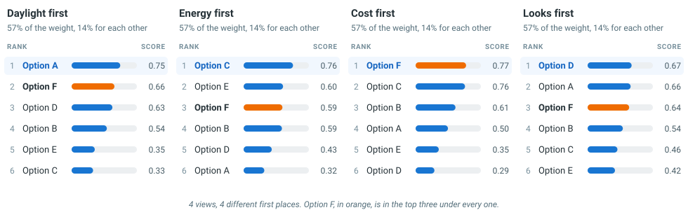

*Six made-up options scored on three measured criteria (daylight, cooling and cost) and one judged by hand (looks). The ranking changes with the weights. An option that stays near the top under every weighting is a robust choice.*

Weighted scoring suits a decision when:

- several goals conflict,
- there are too many options to compare by eye,
- the goals are agreed and every option has a value for each of them, and
- the people involved can say how much each goal matters.

It suits it less when:

- a poor result on one criterion cannot be made up for by a good result on another,
- only a few options are left, in which case compare them directly, or
- people still disagree about the priorities. Then use it to explore the disagreement, not to settle it.

The score is relative. Each measured criterion is scaled against the options you generated, so a high score means good compared with those options, not necessarily good in absolute terms.

### Add your own judgement

Some of what matters will not be in the data. DesignSense gives you three ways to add it:

- A **custom dimension** holds a value that you enter by hand for each option, for example for buildability, for how well it fits the street, or for the client's reaction. Enter it in the inspector, or on the axis.
- **Star ratings** record how much you like an option. They become an axis that you can filter by.
- A **note** records your reasons, for example *four stars, but check glare on the south face*.

You can give custom dimensions and ratings a weight in a [weighted dimension](#score-the-options), like measured columns, so that measured and judged criteria count in the same score.

## Share

*Share your results with others to support the decision.*

Everything below is in the **Share** menu in the toolbar. [Tour this task](https://designsense.app/?tour=share) · [Watch this part](https://youtu.be/KHVPWmzlfpQ?t=271)

| You want to share | Use | What the other person gets |
| --- | --- | --- |
| The reasoning, step by step | **Capture this view**, then **The story** | Each capture saves the current view with its filters, goals and shortlist, and a note you write. Present the captures in a meeting, or download them as a PDF report |
| One picture of the outcome | **Summary image** | One image of the options on your shortlist, in your selection or in a saved set, with findings you can edit. Copy it into a slide or an email, or download it as a PNG |
| The remaining options, as data | **Download (.csv)** | A table of the options that pass your filters or are in your selection. It includes the picture and model columns, your ratings, your custom and weighted dimensions, and your notes, so you can load it again as a smaller study |
| The whole study, to explore | **Link to this dataset** | A link that opens the same data in DesignSense |

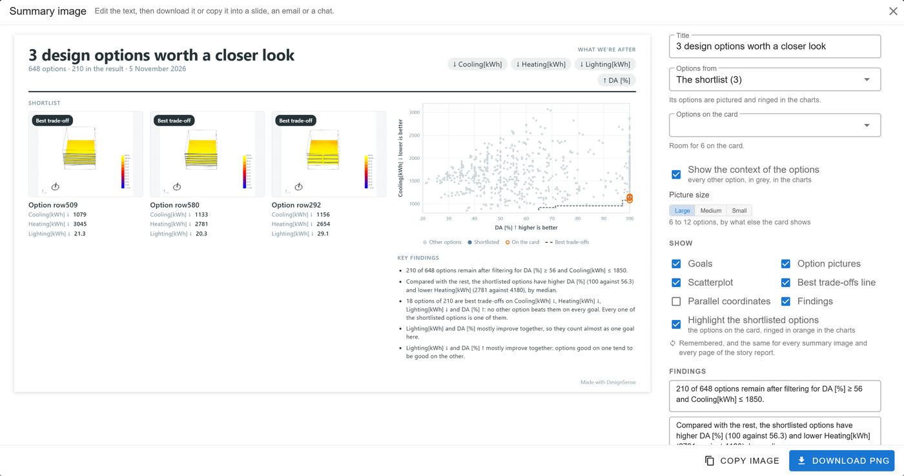

*The summary image for the shortlist: the shortlisted options, how they compare with the rest, and findings you can edit. The checkboxes on the right choose what it shows, down to the best trade-offs line in its scatterplot.*

Two things to know about the link:

- The link holds **only the dataset**. Your filters, saved sets, shortlist, ratings and notes stay in your browser. To share those, send the CSV, the summary image or the report.
- You can only get a link for a study that you opened from a link. A study opened from your computer has no address to share, so [put it on GitHub](#load) first.

**What DesignSense keeps.** For each study, DesignSense keeps your saved sets, shortlist, ratings, notes, custom and weighted dimensions, goals, column choices and story in your browser. They come back when you open the same study again in the same browser. Filters are not kept between visits. To delete what is kept, use **Help ▸ Clear data**.

## Expert mode

Lite mode covers the four tasks with filters. **Expert** mode, switched on in the toolbar, changes how you narrow and adds tools for looking deeper. Everything else in this guide works the same in both modes.

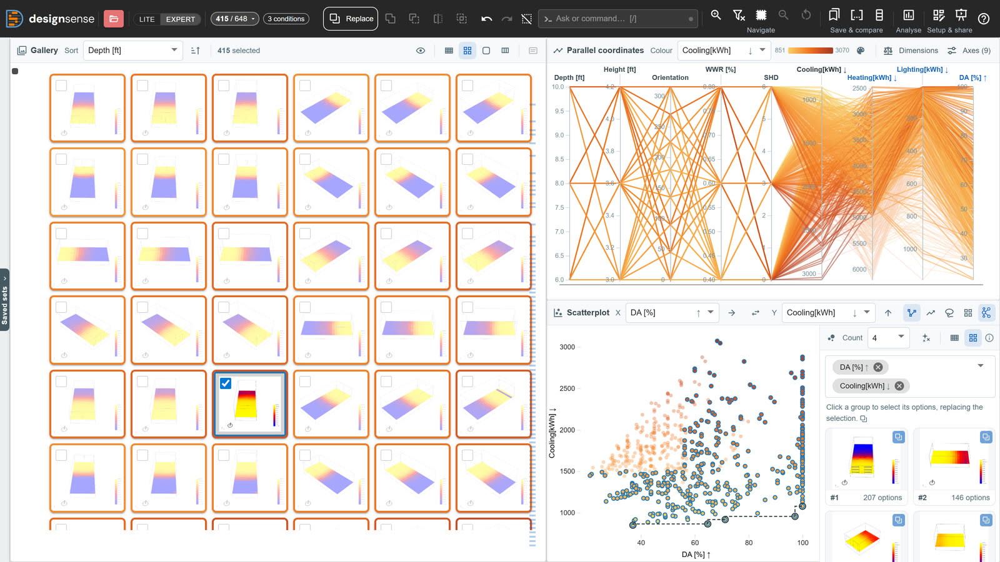

*Expert after three steps: the bright options, plus the cool ones, minus those with high heating. The bar shows the selection operation and the count, and the clusters sit beside the scatterplot.*

| | Lite | Expert |
| --- | --- | --- |
| Narrowing | Filters, which always combine the same way | One selection, changed by each step as you choose |
| The bar at the top | Filter chips | Selection operations, and the selection as a statement |
| Brushing | Several brushes per chart, joined by OR | One brush per chart, combined by the operation |
| Saved sets | Restore brings back the set's filters | Restore applies the operation to the set's options |
| Extra tools | — | Clusters, Analysis, the lasso, a trend line, inspection controls, layout editing |

### Building a selection

You have one selection, and each step changes it by the operation chosen in the bar at the top:

- **Replace** the selection with the new options,
- **Add** them to it,
- **Subtract** them from it,
- **Toggle** them in or out, or
- **Intersect**: keep only those already selected.

Hold Shift to add, Ctrl to subtract, and both to intersect, without changing the bar.

A step can be a brush on an axis, a box or a lasso in the scatterplot, a brush in the expanded overview, a box over pictures in the gallery, a cluster, a single option you click, or a saved set's **Restore**. Restore names the operation it will apply, so it reads **Add** while Add is chosen.

This lets you make selections that filters cannot. For example: the options that are bright or cool, except those that need a lot of heating. Select the bright options, add the cool ones, then subtract the ones with high heating. Unlike filters, the order of these steps changes the result.

**Read the selection.** A strip next to the count shows the selection as one statement, using AND, OR and NOT, simplified to the shortest statement that selects the same options. Click the count to see the full statement and the steps it came from. Undo takes you back through the steps one at a time.

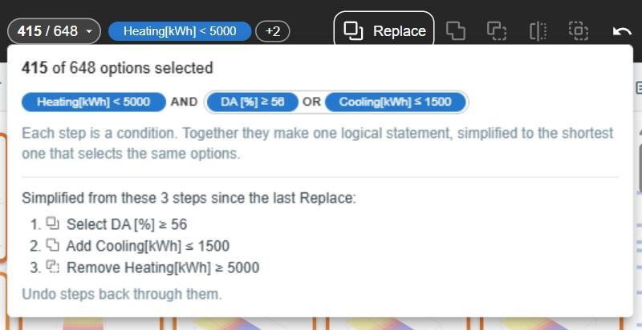

*The selection after the three steps above. The statement describes the 415 options that are selected.*

### Clusters

**Clusters** group options that are similar on the dimensions you choose, starting with the plotted pair, and show the option nearest each group's centre. Group into a set number of clusters (k-means), or let DBSCAN find the groups at the level of detail you choose. Click a group to select its options, by the current operation.

The clusters open from the scatterplot's header, beside the plot or under it in a tall panel. Switching back to Lite shows the overview in their place.

### Analysis

**Analysis** in the toolbar reads the whole collection. It has four parts, each of which folds away and stays as you left it.

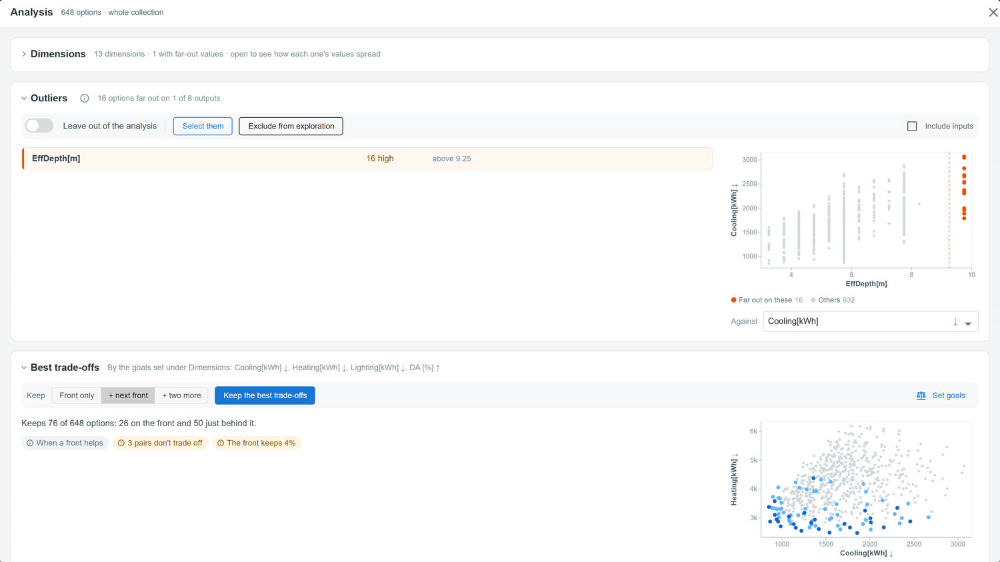

*Analysis of the Windows study, with goals on cooling, heating, lighting and daylight. The dimensions are folded, sixteen options stand far out on effective depth, and the best trade-offs keep 76 options.*

- **Dimensions.** The spread of every dimension, with its average and standard deviation. Folded, it says how many dimensions there are and how many have far-out values.
- **Outliers.** Values far outside the rest of their dimension: more than three interquartile ranges beyond the quartiles. The plot shows where they fall against another dimension. You can leave them out of the analysis, select them, or exclude them from the exploration. An outlier can be the best design or a failed run, so look before leaving it out.
- **Best trade-offs.** The options no other beats on every goal. Choose whether to keep the front only, or the front and the options just behind it, then **Keep the best trade-offs**. **Set goals** opens Dimensions.
- **Sensitivity.** Which inputs move which outputs, for the inputs and outputs you pick.

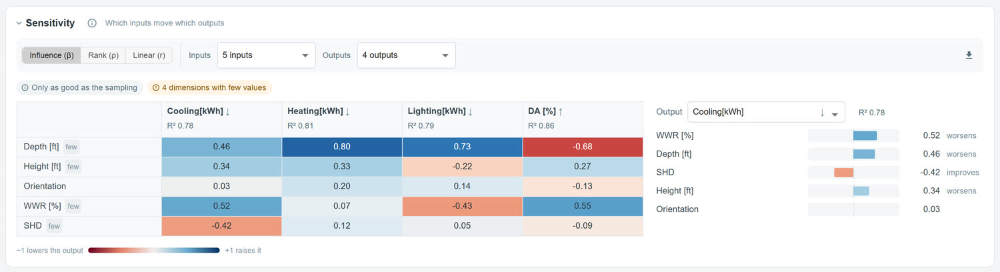

*Sensitivity for the Windows study, read as Influence. Depth raises heating most; WWR raises cooling and daylight. The bars rank the inputs for cooling.*

Sensitivity offers three measures, each from −1 to 1:

- **Influence (β)** is how far an output moves when one input moves, with the other chosen inputs held still. R² under each output says how much of it the chosen inputs explain together.
- **Rank (ρ)** is how steadily two dimensions rise and fall together in rank order, so it also catches relationships that bend.
- **Linear (r)** is how close the pair sits to a straight line.

Blue raises the output and red lowers it; the key under the matrix says so. Click a cell to plot that pair. The bars beside the matrix rank the inputs for one output, and the download saves the numbers as a CSV.

> [!WARNING]
> These are patterns in the options you loaded, not proof of cause. They assume the options sample the design space evenly. If the options came from an optimiser, the inputs already move together, and the numbers reflect that search as much as the design.

### Inspection controls

In Expert, the inspector has two more buttons:

- **Inspect on hover** inspects whatever the pointer is over, without holding Space.
- **Pin** keeps the inspected option in the inspector while you move on.

Both are also in the right-click menu.

### Your layout

In both modes you can choose an arrangement of the panels, choose which views are shown, and drag the edge between two panels to resize them. In Expert you can also move the panels: turn on editing from the layout menu in the toolbar, drag and resize the panels, then press **Done** or the `` ` `` key.

### Switching modes

Your work comes with you:

- **From Expert to Lite**, the selection becomes one *Expert selection* chip, a zoom stays as a *Zoomed in* chip, and the clusters give way to the overview.
- **From Lite to Expert**, the options that pass your filters become the selection, and a zoom stays.
- **In both**, the shortlist, saved sets, goals, ratings and notes stay as they are.

## The research

DesignSense was developed through a design study with practitioners in the built environment.

**[Designing with sense: A critical review and proposal for enhanced design space exploration in generative design](https://journals.sagepub.com/doi/10.1177/14780771241260854)**<br>
[Ahmed M. Abuzuraiq](https://abuzreq.com/) and [Halil Erhan](https://www.sfu.ca/~herhan/) · International Journal of Architectural Computing, 2024

<details>
<summary>Abstract</summary>

Designers in the built-environment disciplines increasingly solve problems using generative design methods, which promise novel and performant solutions to design problems but produce large design spaces that are challenging to explore. Design Space Exploration (DSE) interfaces have been used to understand, refine and narrow design spaces. Still, a critical analysis of current DSE interfaces shows a gap between their features and how designers explore and make decisions. We conducted a design study with domain experts to develop a DSE interface (DesignSense) that tightly integrates and adds to several features found separately in current DSE systems. We present a formative focus group evaluation, which suggested more areas for improvement and highlighted the need to distinguish designers from scientists as two user groups of DSE systems with varying needs, amongst other findings.

</details>

DesignSense is a research project and is still changing. We welcome feedback: use **Help ▸ Send feedback** in the app, or [open an issue](https://github.com/abuzreq/DesignSense/issues). The code is released under the [MIT licence](https://github.com/abuzreq/DesignSense/blob/master/LICENSE).
